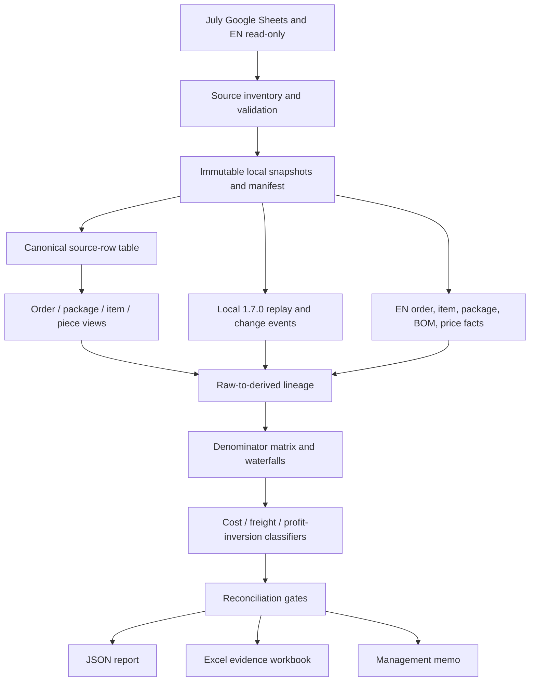

# July Tongtool Profitability Audit - Plan

## Goal Capsule

- **Objective:** Build a read-only, mechanically reconciled audit of the July 2026 Tongtool order Google Sheets that reproduces the questioned averages, traces every material cost and profit field back to its source, and answers why average product cost and freight appear low and why lower collections can coexist with higher reported profit.
- **Authority hierarchy:** Frozen July raw and writeback sheet snapshots are the observed result; EN order/item/package and BOM data explain operational and cost lineage; repository-documented cost and freight rules explain intended behavior; finance policy decisions remain subject to ZJ/finance approval.
- **Execution profile:** `code`. Work from local snapshots, use test-first pure transformations, preserve every input row, and generate JSON, Excel, and Markdown outputs without writing to Google Sheets or production ERPNext.
- **Stop conditions:** Stop before management conclusions if row, revenue, freight, cost-component, or profit reconciliation exceeds the thresholds in the Verification Contract; if a required source column or worksheet is absent; or if the boss's metric cannot be reproduced under any documented denominator.
- **Tail ownership:** Technical discrepancies become explicit correction candidates; finance-policy ambiguities become a separate finance decision list; master-data gaps become a separate user-confirmation list. The audit does not modify July results.
- **Open blockers:** None. Exact July worksheet names and headers are execution-time discoveries handled by the source-inventory gate, not assumptions embedded in code.

---

## Product Contract

### Summary

Create a reusable monthly profitability-audit pipeline and run it first against July 2026.
The pipeline freezes all relevant Google Sheet inputs locally, reconstructs metrics at row, order, package, and finished-piece grains, joins EN facts and special-rule changes, reconciles every total, and produces an evidence workbook plus a plain-language management memo.
The implementation must reproduce the boss's apparent figures before explaining them and must not silently choose a denominator that makes the figures look reasonable.

### Problem Frame

The July Google Sheet contains raw order rows and several derived/writeback views produced by a long-lived Colab pipeline with separate FBA/non-FBA paths, ordinary and `*系数` cost tracks, cost-code fallbacks, EN BOM inputs, freight supplementation, and later special-rule adjustments.
A low average can be a real commercial outcome or an artifact of averaging at the wrong grain, repeating order totals across item rows, leaving costs on only one component row, missing BOM/master data, mixing actual and estimated freight, or comparing unlike profit tracks.
Management needs a traceable answer rather than a fresh recalculation that overwrites the submitted month.

### Actors

- A1. Management: needs plain-language answers to the three challenged metrics and evidence that conclusions cover the full July population.
- A2. Data/software owner: reviews technical findings, approves master-data corrections, and decides whether later pipeline changes should be implemented.
- A3. Finance/ZJ: approves accounting-policy interpretations, including fee, VAT, FX, revenue, and profit presentation choices.
- A4. Executing agent: performs only read-only collection and local analysis, preserves unmatched records, and stops on reconciliation failures.

### Key Flows

- F1. Freeze July sources
  - **Trigger:** The executor starts the July audit.
  - **Actors:** A2, A4
  - **Steps:** Inventory workbook worksheets and headers; identify raw, FBA, writeback, rule, FX, mapping, and cost-source sheets; download values into immutable local snapshots; record retrieval metadata and hashes.
  - **Outcome:** A local evidence bundle can be rerun without touching live July sheets.
  - **Covered by:** R1–R5

- F2. Reproduce the questioned metrics
  - **Trigger:** Snapshots pass source validation.
  - **Actors:** A1, A2, A4
  - **Steps:** Calculate product-cost, freight, collections, profit, and margin summaries under every plausible row/order/package/piece/quantity denominator; separate FBA/non-FBA and ordinary/`*系数` tracks; identify which formula matches the questioned numbers.
  - **Outcome:** Every management number is paired with its numerator, denominator, grain, filters, and source sheet.
  - **Covered by:** R6–R10

- F3. Trace anomalies to source and rule
  - **Trigger:** The reproduced metric shows suspiciously low cost/freight or inverted collection/profit behavior.
  - **Actors:** A2, A3, A4
  - **Steps:** Join raw rows to derived rows, EN order/item/package facts, cost sources, freight sources, and special-rule events; classify every anomaly with evidence and retain unresolved cases.
  - **Outcome:** Each material effect has a lineage and a mechanically provable or explicitly unresolved cause.
  - **Covered by:** R11–R21

- F4. Deliver an accountable audit
  - **Trigger:** Reconciliation gates pass or failures are explicitly reported.
  - **Actors:** A1–A4
  - **Steps:** Write a machine-readable report, local Excel audit workbook, and management memo; separate technical corrections, finance decisions, and master-data actions.
  - **Outcome:** Management can understand the result while future agents can reproduce every number.
  - **Covered by:** R22–R27

### Requirements

**Source freezing and safety**

- R1. The audit must discover the exact worksheets and headers in `通途订单202607` before assuming names beyond the known raw worksheet `2026年7月订单`.
- R2. The audit must inventory and snapshot all relevant July raw, FBA, writeback, combined-output, special-rule, FX, warehouse/mapping, BOM-cost, and freight-source inputs used by the submitted result.
- R3. Each snapshot must record source workbook, worksheet, retrieval timestamp, row count, ordered column list, and a stable content hash when the source can be serialized deterministically.
- R4. Google Sheets and ERPNext are read-only sources; the implementation must not call update, append, clear, duplicate, archive, submit, cancel, or delete methods.
- R5. The audit must never rerun July into an existing worksheet, overwrite a July file, or treat a `写回*` sheet as the raw source.

**Metric reproduction**

- R6. The audit must reproduce product cost, freight, collections/revenue, total cost, profit, and profit margin at source-row, unique-order, package, finished-piece, and shipped-quantity grains where the required keys exist.
- R7. For each average, the audit must report numerator, denominator, population filters, weighting rule, zero/null treatment, and source column rather than outputting an unlabeled `平均值`.
- R8. The audit must compare row-weighted mean, order-weighted mean, package-weighted mean, finished-piece-weighted mean, quantity-weighted unit value, and ratio-of-totals where meaningful.
- R9. FBA and non-FBA populations and ordinary versus `*系数` tracks must be reported separately before any combined view.
- R10. If none of the documented formulas reproduces a challenged number within tolerance, the result must remain `unreproduced` with candidate formulas and differences; it must not select the closest formula silently.

**Stable lineage and reconciliation**

- R11. Each source row must receive a stable lineage key using available order ID, package ID, tracking number, Tongtool SKU, platform SKU, ERP item, source worksheet, and original row number; ambiguous duplicates must receive a deterministic occurrence index and an ambiguity flag.
- R12. The pipeline must preserve raw source row identity while deriving explicit order, package, item, and finished-piece views; it must not group by row position.
- R13. Input rows must reconcile to matched, unmatched, failed, and excluded-with-reason populations with no silent drops.
- R14. Revenue, freight-source, cost-component, total-cost, and profit totals must reconcile independently for ordinary and `*系数` tracks.
- R15. EN fetch failures must be isolated to individual IDs, retained in the report, and must not discard successful IDs from the same bulk request.

**Product-cost diagnosis**

- R16. The audit must classify zero, null, near-zero, and unusually low product costs by evidence including component/placeholder dilution, missing EN item mapping, missing BOM/self-BOM, missing cost-code mapping, delivery-form path, split-package allocation, `split_package_cost_factor`, and cost present on only one row of a multi-row order.
- R17. Piece counts must reuse the established EN order-side rules: ignore blank SKU placeholders, count explicit covers when present, otherwise sum finished-product rows, suppress coexisting `<base>-N` package components, and retain filling-only cases as review records.
- R18. Direct-purchase items with missing cost must be checked against `Item Price`, self-referencing BOM presence, and BOM Cost List behavior without creating or changing BOMs.

**Freight diagnosis**

- R19. The audit must compare `物流商运费`, `通途运费`, `包裹总运费`, final `运费`, and EN `last_leg_fee` where present, using `物流商运费` as the preferred observed freight source and labeling estimates/fallbacks separately.
- R20. Freight findings must distinguish one-per-package charges from repeated item rows, missing or duplicate allocation, historical EN estimates, remaining no-tail-cost records, FBA settlement treatment, special-rule changes, and warehouse/carrier/account gaps.
- R21. Positive or zero FBA tail references skipped by special-rule logic must be labeled as intentional settlement handling; negative references written as differences must be shown separately from ordinary freight.

**Profit-inversion diagnosis**

- R22. The audit must identify lower-collection/higher-profit pairs and cohorts using comparable account, warehouse, SKU/product, quantity, and FBA status rather than arbitrary cross-population comparisons.
- R23. Each inversion must decompose revenue, product cost, Shaoxing processing, overseas processing, first-leg freight, last-leg freight, warehouse cost, VAT, channel fees, PayPal fees, FX, and special-rule deltas.
- R24. The audit must test and label missing cost/freight/fee, FX mismatch, repeated revenue, cost allocated once across repeated rows, negative freight adjustments, margin-versus-absolute-profit confusion, product-mix differences, piece-count differences, and ordinary-versus-`*系数` confusion.

**Outputs and decision boundaries**

- R25. The run must produce a machine-readable JSON report, a local Excel evidence workbook, and a concise Markdown management memo; all outputs must use new timestamped paths under the ignored output directory.
- R26. The Excel workbook must include source inventory, metric definitions, reconciliation, product-cost and freight waterfalls, profit inversions, exception populations, special-rule events, row-level lineage, and unmatched/failed/excluded records.
- R27. Findings must be separated into mechanically provable technical corrections, finance-policy questions for ZJ/finance, and business/master-data fixes requiring user confirmation.

### Acceptance Examples

- AE1. Component rows dilute a row average
  - **Covers:** R6–R9, R16
  - **Given:** One finished product is represented by a cost-bearing line plus zero-cost component or placeholder lines.
  - **When:** The audit computes the row mean and the finished-piece ratio of totals.
  - **Then:** It shows the low row mean as denominator dilution, preserves the raw rows, and does not call the product cost missing when the order-level cost reconciles.

- AE2. Direct-purchase item lacks self-BOM
  - **Covers:** R16, R18
  - **Given:** A sold skeleton maps to an EN item with purchase price but no active default self-referencing BOM and zero BOM-report cost.
  - **When:** Product-cost exceptions are classified.
  - **Then:** The case is labeled `missing_self_bom_candidate` with Item Price and BOM evidence; no BOM is created.

- AE3. Package freight repeats across item rows
  - **Covers:** R6–R8, R19–R20
  - **Given:** One package-level freight amount is repeated on multiple item rows.
  - **When:** Row and package metrics are compared.
  - **Then:** The audit reports both views, detects duplicate allocation if totals multiply, and identifies the package-level denominator as the comparable freight view.

- AE4. FBA positive tail reference is absent from `运费`
  - **Covers:** R9, R20–R21
  - **Given:** A matched FBA rule has a positive or zero tail reference.
  - **When:** The special-rule engine is replayed on frozen local snapshots.
  - **Then:** The event is labeled `fba_tail_skipped_by_design`, not `missing_freight`, and Amazon settlement cost treatment remains visible as a finance-policy dependency.

- AE5. Lower collections but higher profit
  - **Covers:** R22–R24
  - **Given:** Two otherwise comparable order cohorts show lower collected revenue but higher reported profit.
  - **When:** Their cost and revenue waterfalls are compared.
  - **Then:** The audit identifies whether the difference comes from real product mix, missing cost/fees/freight, FX, negative adjustments, or track/grain mismatch and reports unresolved causes without guessing.

- AE6. Source or reconciliation failure
  - **Covers:** R1–R5, R10, R13–R15
  - **Given:** A required worksheet/header is absent or revenue/profit totals do not reconcile beyond tolerance.
  - **When:** The run reaches a gate.
  - **Then:** It writes a failure report with the exact discrepancy, suppresses management conclusions, and performs no source write.

### Success Criteria

- The boss's three questions are answered using reproduced figures whose grains and denominators are explicit.
- Every July input row appears in a matched, unmatched, failed, or excluded-with-reason population.
- Ordinary and `*系数` cost/profit tracks reconcile independently to their source outputs.
- Freight conclusions distinguish actual carrier charge, Tongtool estimate, EN fallback, FBA settlement treatment, and missing data.
- A cheaper execution model can run the workflow without deciding accounting policy or modifying live systems.

### Scope Boundaries

**Included**

- July 2026 Tongtool order and derived Google Sheet data.
- Read-only EN order/item/package, item price, BOM, and BOM-report evidence needed for lineage.
- Frozen replay of the 1.7.0 special-rule engine on local files.
- Full-population diagnostics, evidence workbook, JSON report, and management memo.
- Reusable month-parameterized code, with July as the first run.

**Deferred until findings are reviewed**

- Correcting Colab formulas or Google Sheet data.
- Changing product, freight, fee, VAT, or FX accounting policy.
- Creating additional self-BOMs or modifying EN master data.
- Recomputing July and replacing finance-submitted outputs.
- Automating monthly unattended execution or notifications.

**Outside this product's identity**

- Forecasting future sales or profitability.
- Importing costs into Sellfox.
- Altering Tongtool, EN, or Google Sheet synchronization jobs.
- Treating sampled anomalies as population-wide conclusions without reconciliation.

### Dependencies and Assumptions

- Parent-repository ignored credentials remain the approved read-only access path for Google Sheets and EN.
- July source workbook is `通途订单202607`; `2026年7月订单` is the raw monthly worksheet.
- Exact derived worksheet names and column headers are discovered at run time and written to source inventory.
- `物流商运费` is the preferred observed freight field; `通途运费` is an estimate; `包裹总运费` is not accepted as a stable truth source without row-level evidence.
- Existing order-side and special-rule tests represent settled business semantics and must remain green.

### Sources / Research

- `tongtool_order_cost/AGENT_HANDOFF.md` — module pipeline, 1.7.0 rules, Google Sheet conventions, and self-BOM routing.
- `tongtool_order_cost/tongtool_order_cost/engine_170.py` — ordinary/coefficient targets, before/after events, and FBA tail-reference behavior.
- `tongtool_order_cost/tongtool_order_cost/audit.py` — existing multi-sheet audit workbook conventions.
- `tongtool_order_cost/tongtool_order_cost/io_loaders.py` — current order, rule, and FX loading behavior.
- `tongtool_order_cost/tongtool_order_cost/order_side_input.py` — established order relationship, piece-count, EN fetch, and cost-field normalization.
- `tongtool_order_cost/scripts/audit_august_order_side.py` — month-source read and resilient bulk-fetch patterns.
- `tongtool_order_cost/scripts/run_audit_170.py` — frozen local special-rule replay CLI.
- `tongtool_order_cost/scripts/upload_monthly_order_sheet.py` — monthly source naming and writeback safeguards; write functions are not reused by this audit.
- `tongtool_order_cost/docs/reference/monthly-tail-cost-pipeline.md` — actual/estimated tail-cost source semantics and July coverage history.
- `docs/handoffs/2026-09-21-paused-prs-232-233-234.md` — superseded month-switch rule and current freight-source conclusion.
- `docs/bom_cost_explanation.md` — `皮壳`/`半成品`/`成品` cost-path definitions.
- `docs/solutions/architecture-patterns/en-direct-purchase-self-bom.md` — direct-purchase self-BOM evidence and missing-cost diagnostic.
- `docs/solutions/conventions/tongtu-order-suffix-and-merge-criteria.md` — canonical order suffix and merge semantics.

---

## Planning Contract

### Key Technical Decisions

- KTD1. **Freeze first, analyze second.** `(session-settled: user-directed — chosen over rerunning July in place: July was already submitted to finance and must remain unchanged.)` A collection phase writes immutable local snapshots and a manifest; all calculations consume those snapshots.
- KTD2. **Reproduce every plausible denominator before diagnosing.** `(session-settled: user-directed — chosen over starting from suspected formula bugs: the boss's exact view must be identified before explaining it.)` Metric definitions are data, not hard-coded prose, and every result carries grain and denominator metadata.
- KTD3. **Use explicit grain tables rather than one wide mutable DataFrame.** Preserve source rows, then derive order, package, item, and finished-piece tables with lineage maps. This prevents repeated order/package values from silently contaminating averages.
- KTD4. **Reuse settled order semantics from `order_side_input.py`.** Do not re-invent suffix, TikTok, placeholder, split-package, or piece-count rules in the profitability module.
- KTD5. **Use `物流商运费` as preferred observed freight while preserving every alternative.** `(session-settled: user-approved — chosen over month-based switching or trusting `包裹总运费`: repository evidence shows `包裹总运费` is unstable and `通途运费` is estimated.)`
- KTD6. **Replay 1.7.0 only on frozen local inputs.** Call `engine_170` as a pure local transformation and preserve its change events; never invoke Google Sheet writeback paths.
- KTD7. **Separate evidence from policy.** Code may prove missing, repeated, misallocated, or arithmetically inconsistent fields. It must not decide whether finance should recognize Amazon fulfillment, VAT, fees, or a chosen profit track.
- KTD8. **Fail closed on material reconciliation gaps.** The pipeline may still produce diagnostic files, but the management memo must state that conclusions are blocked until the discrepancy is resolved.
- KTD9. **Generalize the existing August audit helpers instead of copying month-specific network logic.** Move reusable snapshot and resilient-fetch behavior into module code while preserving the August CLI compatibility.

### High-Level Technical Design

### Data Contracts

**Snapshot manifest**

Each source entry records: source type, workbook/site, worksheet/DocType/report, retrieval timestamp, row count, ordered headers/fields, local relative path, hash, read status, and failure reason.
Secrets and raw snapshots remain ignored and are never committed.

**Canonical row identity**

`source_sheet + source_row_number` is always retained.
A derived business key uses normalized order ID, package/tracking identity, Tongtool SKU, platform SKU, ERP item, and deterministic occurrence index.
The pipeline records whether the business key is unique, ambiguous, or incomplete.

**Metric record**

Each metric record includes: metric name, track, FBA scope, grain, numerator expression, numerator value, denominator expression, denominator value, result, zero/null policy, source columns, filters, and reproduction status.

**Exception record**

Each exception includes: stable lineage keys, category, severity, evidence fields, monetary effect when calculable, source references, confidence (`proven`, `strong_evidence`, `unresolved`), and decision owner (`technical`, `finance`, `master_data`).

### Reconciliation Model

- Row conservation: `input = matched + unmatched + failed + excluded_with_reason` for each source and transformation boundary.
- Order conservation: raw unique orders reconcile to canonical orders plus explicit relationship-only aliases.
- Package conservation: package rows reconcile to freight-bearing packages plus missing/failed/excluded packages.
- Revenue conservation: canonical revenue totals equal the selected source output by track and FBA scope within currency tolerance.
- Freight conservation: each freight source total reconciles before allocation; allocated package freight must not exceed source total except for explicitly identified duplication.
- Cost conservation: component sums reconcile to product cost and total cost under the source formula.
- Profit conservation: recognized revenue minus recognized total cost reconciles to reported profit for each track.

### Sequencing

1. U1 establishes immutable source evidence and safety gates.
2. U2 creates canonical grains and lineage; U3 adds EN evidence on top of those identities.
3. U4 builds metric reproduction; no anomaly diagnosis begins before the questioned figures are reproducible or explicitly marked unreproduced.
4. U5 and U6 diagnose product cost, freight, and profit inversions using the same canonical facts.
5. U7 adds reconciliation gates and outputs.
6. U8 documents the run contract and executes the frozen July audit.

### Risks and Mitigations

- **Live worksheets changed since finance submission:** Snapshot metadata exposes current retrieval time, but the audit cannot prove historical cell state without a prior export/version. Label this limitation and compare any available local/Drive historical exports.
- **Derived sheets use different row grains:** Never positional-merge; use explicit business keys, occurrence indexes, and an ambiguity population.
- **FX source is unclear:** Inventory every candidate source and require explicit source labeling. Do not silently use the mode of an order column for management conclusions.
- **FBA fees live outside the visible freight column:** Keep FBA separate and route settlement-recognition questions to finance.
- **EN production reads throttle or partially fail:** Chunk, retry transient statuses, recursively isolate failures, and preserve failed IDs.
- **Workbook size becomes large:** Write detail sheets in deterministic order and keep the JSON summary compact; do not sample away exceptions.
- **Cheaper model overreaches into writes:** The CLI has no write flag and imports no monthly upload functions; verification includes a static safety check for prohibited calls.

---

## Implementation Units

### U1. Read-only source inventory and snapshot bundle

- **Goal:** Freeze the full July evidence set before calculation. Covers R1–R5, AE6.
- **Files:** `tongtool_order_cost/tongtool_order_cost/audit_sources.py`, `tongtool_order_cost/scripts/audit_monthly_profitability.py`, `tongtool_order_cost/tests/test_audit_sources.py`
- **Approach:** Add a source-discovery layer that lists worksheets, fetches headers and values through `tongtool_order_cost.gsheets`, validates known raw-sheet identity, classifies likely worksheet roles by exact title and header evidence, and writes CSV/JSON snapshots plus a manifest under a new timestamped run directory. Add explicit read-only client wrappers or protocol types exposing only list/read operations. Discover related finance-shared rule, FX, mapping, BOM-cost, and freight sources from configured arguments and repository conventions; do not guess silently when multiple candidates exist.
- **Test scenarios:**
  - Known July workbook contains raw and several `写回*` sheets: inventory records all, selects raw only as raw, and snapshots each requested sheet.
  - Missing `订单号` or another required raw header: run stops with a manifest failure and no analysis output.
  - Two candidate FX or rule sheets: both are inventoried and the run requires an explicit selection rather than choosing by position.
  - Deterministic serialization of the same values yields the same hash; changed values yield a different hash.
  - Fake client exposes a write method that would fail if called: snapshot run completes without invoking it.
  - Partial read failure: successful sheets remain snapshotted and the failed sheet is retained with error metadata.
- **Verification:** `uv run python -m pytest tongtool_order_cost/tests/test_audit_sources.py -q`
- **Dependencies:** none

### U2. Canonical grains and raw-to-derived lineage

- **Goal:** Build conserved row, item, order, package, and finished-piece views without positional assumptions. Covers R11–R15, R17.
- **Files:** `tongtool_order_cost/tongtool_order_cost/profitability_audit.py`, `tongtool_order_cost/tests/test_profitability_audit.py`
- **Approach:** Define dataclasses or typed records for lineage keys, grain views, and reconciliation counters. Preserve source row numbers. Normalize IDs with existing `order_side_input` helpers. Join derived sheets using explicit available keys and deterministic occurrence indexes. Generate ambiguity, unmatched, failure, and excluded populations rather than dropping them.
- **Test scenarios:**
  - Repeated order totals across multiple item rows remain one order value in the order view but remain visible on every source row.
  - Duplicate business keys receive deterministic occurrence indexes and an ambiguity flag.
  - Blank SKU placeholder rows remain in source lineage but contribute zero finished pieces.
  - `<base>` plus `<base>-2` within one order counts one finished product; a standalone `<base>-2` counts normally.
  - Filling-only order is preserved with `只发部件·待复核` rather than dropped.
  - Conservation report exactly accounts for matched, unmatched, failed, and excluded rows.
- **Verification:** `uv run python -m pytest tongtool_order_cost/tests/test_profitability_audit.py -q -k "lineage or grain or conservation or piece"`
- **Dependencies:** U1 snapshot schema

### U3. EN order, item, package, and cost-evidence enrichment

- **Goal:** Add read-only EN operational and master-data evidence to canonical July identities. Covers R15–R18.
- **Files:** `tongtool_order_cost/tongtool_order_cost/audit_sources.py`, `tongtool_order_cost/tongtool_order_cost/profitability_audit.py`, `tongtool_order_cost/scripts/audit_august_order_side.py`, `tongtool_order_cost/tests/test_audit_sources.py`, `tongtool_order_cost/tests/test_audit_august_order_side.py`, `tongtool_order_cost/tests/test_profitability_audit.py`
- **Approach:** Extract the resilient chunking/binary-isolation pattern from `audit_august_order_side.py` into reusable module code. Fetch July `Tongtool Order` parents and child items/packages by explicit IDs. For missing-cost ERP items, read Item, standard purchase Item Price, active/default BOM and self-BOM evidence, and report values where available. Keep the August CLI functional by delegating to the shared helper.
- **Test scenarios:**
  - One failing ID in a bulk request is isolated while neighboring IDs are retained.
  - 404 is classified missing; transient statuses retry; permanent failure remains failed with ID and error.
  - Child order parent state remains tri-state unless the parent was explicitly checked.
  - Direct-purchase item with purchase price and no self-BOM is classified as a candidate; an existing active default self-BOM is not.
  - No test or runtime path creates, submits, updates, cancels, or deletes an EN document.
  - Existing August order-side tests remain unchanged or receive only compatibility updates.
- **Verification:** `uv run python -m pytest tongtool_order_cost/tests/test_audit_sources.py tongtool_order_cost/tests/test_audit_august_order_side.py tongtool_order_cost/tests/test_order_side_input.py tongtool_order_cost/tests/test_profitability_audit.py -q`
- **Dependencies:** U2 identities

### U4. Metric denominator matrix and boss-figure reproduction

- **Goal:** Reproduce the questioned averages and expose grain/track differences before diagnosis. Covers R6–R10, AE1, AE6.
- **Files:** `tongtool_order_cost/tongtool_order_cost/profitability_audit.py`, `tongtool_order_cost/tests/test_profitability_audit.py`
- **Approach:** Implement declarative metric definitions for product cost, freight, collections/revenue, total cost, profit, and margin across row/order/package/piece/quantity grains. Calculate FBA/non-FBA and ordinary/`*系数` partitions. Add a reproduction matcher that compares candidate metrics to optional boss-provided target values; when no targets are supplied, output the complete denominator matrix without claiming a match.
- **Test scenarios:**
  - Two zero-cost component rows plus one cost-bearing product row produce different row mean and piece ratio-of-totals with correct labels.
  - Repeated order revenue does not multiply in order-grain totals.
  - FBA and non-FBA, ordinary and `*系数`, remain separate and combined results equal explicitly documented aggregation.
  - Zero denominator returns a structured undefined result, not infinity or zero.
  - Candidate within currency tolerance is `reproduced`; none within tolerance is `unreproduced` with differences.
  - Null and zero policies are visible in every metric record.
- **Verification:** `uv run python -m pytest tongtool_order_cost/tests/test_profitability_audit.py -q -k "metric or denominator or reproduce"`
- **Dependencies:** U2; U3 where EN piece facts improve denominators

### U5. Product-cost and freight diagnostic classifiers

- **Goal:** Explain low product cost and freight using full-population evidence. Covers R16–R21, AE1–AE4.
- **Files:** `tongtool_order_cost/tongtool_order_cost/profitability_audit.py`, `tongtool_order_cost/tests/test_profitability_audit.py`
- **Approach:** Add ordered classifiers that distinguish arithmetic dilution from missing data and intentional rule behavior. Product-cost categories include placeholder/component dilution, missing mapping, missing BOM/self-BOM, cost-on-one-line, delivery-form path, and split allocation. Freight categories compare all available freight fields and label actual, estimate, EN fallback, FBA settlement skip, negative special-rule difference, missing, duplicate, and allocation mismatch. Use monetary-effect calculations only when a valid comparison baseline exists.
- **Test scenarios:**
  - Cost exists at order grain but row mean is diluted: classify dilution, not missing cost.
  - No mapped EN item: classify mapping gap before BOM gap.
  - Standard purchase price exists and self-BOM is absent: classify self-BOM candidate.
  - Package freight repeated on three item rows: detect whether the derived total duplicated it or merely displayed it repeatedly.
  - `物流商运费` is present while `通途运费` differs: label observed versus estimate without replacing either.
  - Positive/zero FBA reference skipped by engine behavior is intentional; negative reference is a separate difference event.
  - Missing actual freight but EN fallback present is not counted as actual coverage.
- **Verification:** `uv run python -m pytest tongtool_order_cost/tests/test_profitability_audit.py -q -k "product_cost or freight or self_bom or fba"`
- **Dependencies:** U3, U4

### U6. Profit-inversion cohort analysis and special-rule replay

- **Goal:** Explain lower-collection/higher-profit cases using comparable cohorts and before/after special-rule evidence. Covers R22–R24, AE5.
- **Files:** `tongtool_order_cost/tongtool_order_cost/profitability_audit.py`, `tongtool_order_cost/tongtool_order_cost/engine_170.py`, `tongtool_order_cost/tests/test_profitability_audit.py`, `tongtool_order_cost/tests/test_engine_170.py`
- **Approach:** Run `engine_170` against frozen local order/rule/FX inputs and attach its change events to lineage keys. Form comparable cohorts by account, warehouse, product/SKU, quantity band, and FBA state. Rank inversions by materiality and decompose revenue and every cost/fee component. Keep real mix/quantity differences separate from likely data defects. Modify `engine_170.py` only if a tested read-only integration seam is needed; do not alter settled formulas during the audit.
- **Test scenarios:**
  - Lower revenue and lower real cost yields higher profit legitimately and is labeled mix/cost difference, not defect.
  - Missing product cost or freight creates a false inversion and the monetary effect is shown.
  - Revenue repeated across component rows is detected before cohort comparison.
  - Negative freight adjustment increases profit and is traced to its rule event.
  - Ordinary profit and `订单利润*系数` disagree: both are shown and track confusion is flagged.
  - FX mismatch and missing VAT/channel/PayPal fee each produce separate evidence categories.
  - Existing `engine_170` behavior remains green, including FBA tail rules.
- **Verification:** `uv run python -m pytest tongtool_order_cost/tests/test_engine_170.py tongtool_order_cost/tests/test_profitability_audit.py -q -k "profit or inversion or special_rule or fx or fee"`
- **Dependencies:** U4, U5

### U7. Reconciliation gates and audit deliverables

- **Goal:** Produce reviewable JSON, Excel, and management outputs only when evidence state is explicit. Covers R13–R15, R25–R27, AE6.
- **Files:** `tongtool_order_cost/tongtool_order_cost/profitability_report.py`, `tongtool_order_cost/tongtool_order_cost/audit.py`, `tongtool_order_cost/scripts/audit_monthly_profitability.py`, `tongtool_order_cost/tests/test_profitability_report.py`
- **Approach:** Build a profitability-specific writer that reuses existing formatting patterns without overloading the 1.7.0 workbook. Add gate results and conclusion eligibility to JSON. Write an Excel workbook with deterministic sheet names and a Markdown memo whose three headline answers cite the reproduced metric definitions and largest proven drivers. When gates fail, write diagnostics but replace conclusions with a blocked statement.
- **Required workbook sheets:** `00_管理摘要`, `01_指标口径`, `02_数据源清单`, `03_数量对账`, `04_收入利润对账`, `05_产品成本瀑布`, `06_运费瀑布`, `07_利润倒挂`, `08_产品成本异常`, `09_运费异常`, `10_汇率税费异常`, `11_FBA非FBA`, `12_仓库账号渠道`, `13_特殊规则事件`, `14_行级血缘`, `15_未匹配失败排除`, `16_决策清单`.
- **Test scenarios:**
  - Passing fixture writes JSON, all required sheets, and a three-question memo with metric citations.
  - Row-conservation failure writes diagnostics and marks management conclusions blocked.
  - Profit formula mismatch above tolerance blocks conclusions even if row counts pass.
  - Excel sheet row counts equal corresponding JSON population counts.
  - Output path already exists: CLI creates a new timestamped directory and never overwrites.
  - Technical, finance, and master-data findings appear in separate decision lists.
- **Verification:** `uv run python -m pytest tongtool_order_cost/tests/test_profitability_report.py -q`
- **Dependencies:** U1–U6

### U8. July run contract and operational documentation

- **Goal:** Make the audit executable by a cheaper model without live-write risk or hidden business decisions. Covers R1–R27.
- **Files:** `tongtool_order_cost/README.md`, `tongtool_order_cost/AGENT_HANDOFF.md`, `tongtool_order_cost/docs/reference/monthly-profitability-audit.md`, `tongtool_order_cost/docs/reference/index.md`, `index.md`
- **Approach:** Document the two-phase CLI (`snapshot` then `analyze`, or equivalent explicit subcommands), exact July invocation, credential lookup through existing ignored parent-repository files, expected outputs, stop conditions, and the rule that the management memo is invalid when gates fail. Include a source-role checklist and decision-owner matrix. Run repository index updates required for Markdown changes.
- **Test scenarios:**
  - A dry CLI help invocation exposes no apply/write/update option.
  - Documented July command resolves to `通途订单202607` / `2026年7月订单` and a new local output directory.
  - Running analysis from a completed snapshot requires no Google or EN network access.
  - Documentation clearly distinguishes technical corrections, finance decisions, and master-data changes.
- **Verification:** `uv run python tongtool_order_cost/scripts/audit_monthly_profitability.py --help`; `uv run python scripts/update_index.py`
- **Dependencies:** U7

---

## Verification Contract

### Test and quality gates

| Gate | Command or check | Proves | Required result |
|---|---|---|---|
| Focused unit tests | `uv run python -m pytest tongtool_order_cost/tests/test_audit_sources.py tongtool_order_cost/tests/test_profitability_audit.py tongtool_order_cost/tests/test_profitability_report.py -q` | New source, lineage, metric, classifier, and report behavior | All pass |
| Regression tests | `uv run python -m pytest tongtool_order_cost/tests/test_order_side_input.py tongtool_order_cost/tests/test_audit_august_order_side.py tongtool_order_cost/tests/test_engine_170.py -q` | Settled order semantics and 1.7.0 formulas remain intact | All pass |
| Full module tests | `uv run python -m pytest tongtool_order_cost/tests -q` | No module regression | All pass |
| Static write-safety review | Search new audit files for Google/ERP update, append, clear, submit, cancel, delete, upload, and monthly writeback calls | Audit cannot modify live systems | Zero prohibited call sites; read-only wrappers only |
| Secret scan | `uv run python scripts/check_secrets.py` | Credentials and snapshot data are not committed | Zero findings |
| Documentation index | `uv run python scripts/update_index.py` | Root documentation index reflects new reference docs | Clean completion |
| Source inventory gate | Inspect generated manifest and JSON | Exact sheets/headers and snapshot hashes are recorded | Every required source is present or run is blocked with reason |
| Row conservation | Generated JSON reconciliation | No silent row loss | Exact equality; tolerance 0 rows |
| Monetary reconciliation | Generated JSON reconciliation | Revenue, freight, cost, and profit lineage is arithmetically sound | Absolute difference <= CNY 0.01 per partition and <= CNY 0.10 whole-month rounding aggregate; otherwise blocked |
| Metric reproduction | `01_指标口径` and JSON metrics | Boss figures have known denominator and population | Reproduced within CNY 0.01/rate 0.01 percentage point, or explicitly `unreproduced` with no conclusion claim |
| Population coverage | Exception sheets and JSON counts | Findings cover the full month | Every source row classified; no sample-only conclusion |

### July execution checks

1. Run snapshot collection into a new timestamped ignored directory.
2. Review the manifest before analysis: exact worksheet titles, row counts, headers, hashes, and failures.
3. Run analysis only from the snapshot directory.
4. Verify raw row, unique-order, package, and piece populations against JSON and Excel.
5. Verify FBA/non-FBA and ordinary/`*系数` totals independently.
6. Compare `物流商运费`, `通途运费`, `包裹总运费`, final `运费`, and EN `last_leg_fee` totals and coverage.
7. Confirm the management memo cites exact workbook sheets/metric IDs and contains no unqualified conclusion if any material gate failed.
8. Confirm no Google Sheet modified timestamp or EN document state changed as a result of the audit.

### Review thresholds

- **Block management conclusion:** any unaccounted row; missing required source; unreconciled revenue/profit above tolerance; unknown track mixing; or material source ambiguity without a separately reported range.
- **Allow conclusion with limitation:** EN enrichment failures that affect only a quantified non-material population and do not break source-output arithmetic; the memo must state count and monetary exposure.
- **Finance review required:** recognition of FBA fulfillment, VAT, channel fees, PayPal fees, FX authority, collections definition, or selection of ordinary versus `*系数` profit as the official view.
- **User approval required before later fixes:** Google Sheet/Colab corrections, EN mappings, self-BOM creation, or any backfill/recomputation of July.

---

## Definition of Done

### Global completion

- The July source bundle is immutable, timestamped, hashed, ignored by Git, and contains no credentials.
- The questioned figures are reproduced with explicit metric definitions or are marked unreproduced without speculative diagnosis.
- Every source row and monetary total is reconciled under the stated gates.
- Product-cost, freight, and profit-inversion findings cover the full population and preserve unmatched/failed/excluded records.
- JSON, Excel, and Markdown outputs agree on counts and headline totals.
- Management receives three plain-language answers with quantified drivers and limitations.
- Technical corrections, finance-policy questions, and master-data fixes are separate lists with owners.
- No live Google Sheet or EN write occurred, and July submitted outputs were not overwritten or recomputed in place.
- All tests, secret scanning, and documentation index updates pass.
- Experimental or abandoned audit code is removed from the final diff.

### Per-unit completion

- U1. All required sources are inventoried and snapshotted or the run stops with an accountable missing-source report.
- U2. Canonical grains and lineage conserve every row and pass established piece-count semantics.
- U3. EN enrichment isolates failures, preserves successful results, and performs no writes.
- U4. Metric matrix exposes every denominator and separates FBA/non-FBA plus ordinary/`*系数` tracks.
- U5. Product-cost and freight anomalies have evidence-based categories and quantified populations.
- U6. Profit inversions use comparable cohorts and decompose special-rule, FX, fee, and cost effects.
- U7. Deliverables enforce reconciliation gates and never overwrite prior outputs.
- U8. Documentation lets a new executor run snapshot then offline analysis without inventing business rules.
