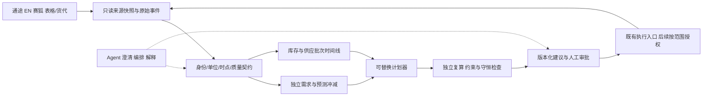

# 共同框架候选

本稿由 Codex 提出，对照 Claude #300 固定 `e0975b97819cb967009260795b52c7ed18c04dc2` 后形成；**不是三方已批准的最终设计**。来源与争议见[定向复审](claude-review.md)、[决策表](decisions.md)。原始独立报告保留，不用共识代替证据。

## 1. 总体目标与已知边界

老板每次审批应能回答：为什么现在下单、下多少、何时可售、占多少资金、不批会怎样、与上次批准计划差在哪里。最终覆盖终端需求、库存、补货、生产、出库、头程与海外实收；V1 可以窄切片，但整体契约不能省略后半程。

- 保留现有交易系统；当前通途运营库存作为候选可用库存源并带质量标记，EN 提供制造/出库/BOM事实。不把通途余额直接写入 EN Bin/Stock Ledger。
- 确定性计算负责数值、约束与复算；Agent 做语义澄清、编排、解释和草拟，权限由服务端控制。
- 历史阶段 A 已完成、B 未启动；当前不采用 TSFM。公司级方向保留分段/全局 LightGBM、长尾 Croston/TSB、Conformal 和调和；八 SKU 统计试点不是对该方向的替代批准。
- PJ/Jack 敏感头程资料未交付；先定义接入与关联契约，不猜供应商字段，不等待大屏。
- 本轮只做本地合成验证；不访问 EN 生产，不发通知、不创建业务草稿或库存记录。

## 2. 总体架构

来源快照、共同事实契约、计划器输入输出应能独立导出。换数据库、求解器或展示入口时，不重新定义销量和在途。

| 层 | 负责什么 | 当前候选/验收 |
|---|---|---|
| 接入与原始证据 | 复用客户端；原始单据/事件、获取时间、来源行、完整性清单 | 可重跑、可定位未匹配；失败不改写为0 |
| 事实与映射 | 规范商品/组件/套件、仓库、单位、行级分配、事件与有效时点 | 一件货和一份需求不因跨系统重复出现而重复计算 |
| 分析查询 | 同一快照下的库存、需求、供应、成本和异常 | DuckDB/Parquet可本地试点；EN快照为可选呈现，非另一库存账 |
| 预测与政策 | 统计基线/已有公司级方向、区间、预测冲减、目标服务定义 | 冻结方法后按标签可知时间验证；目前不确定最终模型 |
| 计划与情景 | 分期净需求、BOM、MOQ、交期、资金/产能等适用约束 | EN原生、成熟引擎、专项组件按相同输入比较 |
| 审批与执行 | 建议版本、输入摘要、有效期、人工覆盖、授权范围、结果读回 | 本轮只生成本地建议；创建草稿也是写操作 |
| 呈现与Agent | 一页审批、源单下钻、异常责任与下一行动 | 先选一个入口；大屏不先于底层契约 |

## 3. 最小实体与键契约

| 实体/关系 | 必须区分的身份与字段 | 不能简化成 |
|---|---|---|
| 原始事实行 | `source_system + source_entity + source_row_id + revision`；业务发生与观察时间 | 只有SKU/金额的汇总 |
| 终端需求行 | 原订单/行、需求类型、承诺日期、数量/UOM、取消/变更链、渠道/仓 | 所有EN SO均是新增终端需求 |
| 预测桶与冲减 | 规范商品×服务池×周期；匹配订单类型/窗口/版本；保留已冲减量 | forecast + 已包含订单直接相加 |
| 映射与配套 | 原SKU、规范成品/部件/套件、关系类型、数量系数/UOM、有效期、证据/版本 | 剥后缀即同一物料，或一个split_group充当配方 |
| 生产数量 | 首道/末道报工、已提交制造入库、物理出库分别有凭证与UOM | 互相替代或强制首道≥末道≥入库≥发运 |
| DN 行 | `Delivery Note Item.name`是自身ID；`parent`是DN头；`so_detail`是SO行外键；`against_sales_order`是SO头外键 | 将so_detail当DN行主键 |
| 供应批次 | 内部批次身份、原始来源crosswalk、数量/单位、目的地、状态余额与可售日期区间 | DN数量 + 通途PO在途 + 货代在途 |
| 运输 | 批次/票、提单、设备、共享运输腿各有身份；DN行→票数量分配；供应商命名空间 | 柜号、SO号或货代单号作为万能键 |
| 原始收货行 | `source_receipt_id + source_receipt_line_id + revision`；一行可分配给多个DN行 | `(batch,item)`唯一键 |
| 收货分配 | 原始收货行→DN行/供应批次的数量，gross/accepted/damaged等互斥分类 | 一行收货必然只来自一张DN |
| 库存快照 | 来源SKU×来源仓×库存状态×snapshot_id，字段定义、预留关系和完整性 | 把当前余额拆回不存在的历史批次；或已扣预留后再扣一次 |

没有可靠批次关联的库存/在途保留为“未对齐余额”，不能编造batch_id后宣称去重成功。部分建议受阻时可呈现其余范围，但须列阻断数量与影响，不能静默把未知补0。

## 4. 数量、时间与反向流

1. 预测桶内100已包含30真实订单，则剩余预测70、总需求100；内部补货SO不再加一次。若真实订单120，总需求至少120。匹配窗口/客户/仓和取消语义待业务确认，算例不默认全渠道互冲。
2. `净交付=正向DN−已确认退货`是商业指标；物理发运、返运、损坏、替换是不同流，不能用净交付抵消已发生的运输。退货是否重开履约必须由退款/补发义务定义，不无条件加回未交数量。
3. 当前余额按**同一cutoff、同一单位、同一货物范围的互斥状态**对账；累计到港/清关/签收事件另存。同一100件依次经过三个里程碑仍是100件，不能相加成300。
4. 收货100可拆98合格+2损坏；合格不必等于可售，还可能待检/加工/上架。是否能与通途当前可用余额对应须另核来源，而非直接加上。
5. 计划必须按可售日期区间分期。账面供给足够覆盖6个月，不证明第3个月不会缺货。生产、物流、清关、加工/上架提前期分开记录，无法估计时给情景而非假确切日期。
6. 历史as-of仅能使用当时已观察到的数据和当时生效的映射。今天下载的已修订旧订单不能自动称为历史快照；无法重建的部分标注限制。13个月保留是候选政策，不等于已具备多年回测能力。

上述规则的可执行反例见[13个合成样例](semantic-examples.md)。它们是契约参照，不是已实现的统一事实层。

## 5. 下一阶段：以门槛替代承诺日期

| 阶段 | 交付 | 通过门槛/未通过处理 |
|---|---|---|
| G0 对齐契约 | 业务范围、实体键、数量/UOM、需求类型、预留/可用定义和未决项 | 双方对结构达成一致；业务数值未知可保留，影响必须标出 |
| G1 本地守恒回放 | 合成正/负例；之后由授权流程提供脱敏原始快照；只读提取计划 | 每个输入有输出/隔离去向，数量可追溯；本轮仅完成合成例 |
| G2 数据查询spike | 通途只读快照→本地查询→一个建议出口；订单/在途共享cutoff | 完整性、坏行、映射、重复、发布一致性通过；不先搭完整BI栈 |
| G3 模型与计划对照 | Claude修正预测隔离后重跑；同快照对比轻量与EN原生可表达部分 | EN库存不符时不能直接使用原生projected_qty；显式注入/导入测试数据或判该路径不适用 |
| G3b 成熟引擎影子样例 | 当共同样例存在BOM/资源/时间约束，或自组需重写计划能力时，固定正式CE版本/许可 | 先做最小导入导出与一组约束，不默认3–4周工程；支持不了即记录淘汰证据 |
| G4 业务影子审批 | 与已批准人工计划逐项解释差异，绑定run_id/成本/缺数与假设 | 老板能判断方案、量/金额可复算、例外有责任人；不用模型榜单替代此验收 |
| G5 授权上线 | 单独确认读写范围、草稿/提交权限、过期和变更处理、回读异常 | 不由研究通过自动获得生产写入许可；本轮未启动 |

可并行：无依赖的源字段核对、Claude E1修复、合成例评审。依赖必须顺序：先统一事实→再比较计划→再业务试用。现场数量抽样优先测试环境；本轮不访问生产，测试数据不能证明生产真实性。

## 6. 完成定义

“研究与候选设计完成”不等于“总体方案批准”或“实施就绪”。本轮可交付共同框架候选、可复算反例、定向复审和分歧表；只有实际证据达到G0–G4相应门槛后，才能裁决引擎和参数。不同实现分支可保留，共用输入/输出契约与验收样例即可比较。
