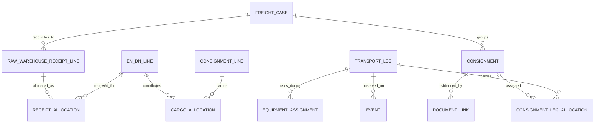

# 头程进度底层模型：从 EN DN 到海外仓实收

## 范围与建议

本研究只讨论采集与关联头程进度的底层数据模型和接口候选。PJ/Jack 现有大屏未交付且涉及敏感信息，因此不假定其数据/架构可用，也不把其计划产品化；优先验证能够读取哪些供应商事件、如何可靠连回 ERPNext Delivery Note（DN）明细、如何对账仓库收货。这里不承诺智美通或其他货代已实现任何标准 API。标准公开只描述语义/接口格式，逐家要确认当前产品、权限、字段、更新频率、历史回补和改错机制。

推荐内部采用**最小自有事件模型**：保留供应商原始事件，加一层受控映射成“运输单元/运输委托—文件—多式联运腿—事件—货物分配—仓库实收”。建议借 UN/CEFACT 与 DCSA 的运输语义、用 OTM 5 的 Consignment/Trip/Actor/Action 关系作轻量映射参考；仅在确有箱/托/件级物理聚合追踪需求时借用 GS1 EPCIS Aggregation/CBV 事件词汇。不要为这个任务引入全量 EPCIS Repository/平台。厂商能否直接输出这些格式尚待验证。

## 参与方与业务对象不能混为一类

一个头程任务至少区分下列角色（同一法人可同时承担多角，但存多角色）：

- **头程供应商/货代或合同责任方**：接受委托，可能组织拼货、订舱、报关、转包、代采事件；有自己的业务号。通常是我方首先要接数据的一方。
- **实际承运人**：在某一腿实际载货，例如海运船公司、卡车公司、铁路/空运承运人。DCSA 主要面向集装箱海运承运人事件，不能假设覆盖货代的所有门到门状态。
- **分包/场站/口岸/代理**：起运仓、集货仓、码头、转运港、目的港代理、清关行、末端卡车及交接仓。作为事件观察方或地点/交接方独立记录。
- **收货节点**：海外公司仓或第三方仓库；只有其实际收货单/入库/点数才确认实收件数，不能用“清关完成”“派送中”推定入库。
- **业务货物与单据**：DN 明细、货代委托/Consignment、Booking、House/Master B/L、Container/运输设备、运单、仓库收货记录是不同对象。提单号、Booking、集装箱号可互相关联，但不可压成一个万能 shipment_id。

## 建议的最小关系模型

以我方内部 `freight_case_id`（运输跟踪聚合视图，不冒充供应商号）统筹记录，关系采用显式分配表而不是 DN→一个提单的外键：

| 实体 | 关键字段/含义 | 关键规则 |
|---|---|---|
| EN DN 明细 | `dn_name + dn_item_row`、Item/SKU、发出数量/UOM、仓、posting 时间 | 原单据/行是可追溯需求/发运源头；不要用订单头或 SKU 汇总替代明细 |
| Freight case / 装运批 | 内部 ID、承运范围、起讫仓/计划窗口、由事件流投影的当前状态 | 状态投影与来源事件分层保存；状态可重建，不覆写原始事件。一票货代委托可连接多张 DN，一张 DN 可分几次发走 |
| Cargo allocation | DN 行↔委托/Consignment line↔数量/UOM、分配来源/置信度/确认人 | 多对多桥；分批、合并、退运/补发用多条分配表达。数量守恒由分配与实收分别对账 |
| Booking / House B/L / Master B/L / 其他单据 | `document_type + issuer + external_id`、签发/版本、父文档/关联文档 | 一个 Booking 可拆多 House B/L，一张 Master 可罩多个 House；按样例证实后才设具体规则。原始扫描件/内容权限另控，本任务不抓真实单据 |
| Consignment / 运输委托 | 货代或合同承运方的行政运输单位、货物行、发货/收货方 | 可对应一个或多个 DN；合同/路由上的货物集合。不要与 physical container 或 ERP Shipment 同义 |
| Transport leg | 可复用的物理运输行程/服务段 ID、运输方式、起讫地点、实际承运方、计划/实际区间、来源引用 | 逐物理腿记录卡车→海运→铁路/卡车等；多票货可共用同一条运输腿。换船、转运、拆箱或换末端车时建对应新腿；Consignment 与 leg 通过分配桥关联，保留各票分配量/单位与装载区间，不因 HBL 不同而复制同一航次或同一腿事件 |
| Equipment assignment | container/托盘/卡车/箱号、与货物/腿的关系起止、装入/拆出事件 | 集装箱载多家货代/多 Consignment 很常见；一个 Consignment 也可能跨箱。只对明确物理共处的时间段建装载关系 |
| Event (append-only) | 来源系统/事件 ID/修订号、更正/撤销标志及引用、原始码/文本、统一事件类与 `planned`/`estimated`/`actual` 分类、`event_time`（事实发生时间）/`observed_at`（我方看到记录的时间）、位置、actor/performer、关联 case/leg/equipment（可经 leg 分配解析到多票 consignment）、原始 payload 引用 | 同一物理腿/供应商事件只记录一次，可关联多票货；estimated ETA 始终是估计，不自动升级 actual。实际到港需有新的 actual 来源事件证据；更正/撤销另字段并保留来源修订链 |
| Raw warehouse receipt line | 目标仓、原收货凭证/行 ID、原始 SKU/批次/数量/UOM、点收时间、原始状态/备注 | 原样保留仓库收货明细；一条原始收货行可涵盖多个 DN 来源，不把原始记录强行改写成单一 DN 行 |
| Receipt allocation | 原收货行↔EN DN 行/Consignment line 的分配数量/UOM、类别（gross/accepted/damaged/rejected 等）、匹配依据/确认人 | 用桥表表达一条收货行分配多个 DN 行及一个 DN 跨多次收货；分配数量按原始数量类别守恒。未匹配数量保留为异常，不按 SKU 猜 |

### 关联与数量守恒

- `EN DN line → cargo allocation → consignment line` 可多对多；一行 DN 拆多票/多仓，一票 Consignment 合并多张 DN。`Consignment ↔ Transport leg` 也必须通过分配桥多对多：同一海运航次/同一实际运输腿可承载多个 HBL/Consignment，各票仅分配自己的货量和区间；同一票也可跨多腿。航次及事件只建一次并被多票引用，不因 HBL 重复。货代号、HBL/MBL、Booking、Container 均是**带签发方命名空间**的外部标识，需保存原值、类型、issuer、有效时间及匹配依据。不能只凭相同订单号或 SKU 近似自动确认。
- 运输设备和 Consignment 的关系按“某次装入—某次拆出/腿区间”记录，不设永久单一 container 外键。一个 LCL 柜可含多家货主/多个 HBL；某票货也可能中途换柜。
- DN发出量、已分配运输量、每腿观测量、仓库原始行量及其 DN 分摊、accepted/damaged/rejected 数量分字段并按 DN 行/UOM 对账。原始收货行量必须等于该行各类分摊之和；某 DN 行累计分摊也须可与已发数量核对。实收 ≤ 已发分配是常见业务约束，但超收、单位换算、拆分和补发应显式报告，不能静默裁剪。到港/清关/放行只表明事件，未收货数量仍在途/待交接。
- `planned`（计划）、`estimated`（预测 ETA）与 `actual`（有来源证据的实际事件）是不同分类；事件的 `event_time` 是事实发生时间，`observed_at` 是我方看到/收到记录的时间，二者不可互换。当前 view status 是从来源事件投影的独立层，保留来源系统、原始状态与统一映射。迟到事件可以有旧 `event_time`、新 `observed_at`，按事件身份/修订规则纳入历史与当前投影；新 revision 可修订同一事件，但 estimated 永不因时间经过或状态排序自动升级 actual，只有新的 actual 来源事件证据才可更新实际状态。更正/撤销用显式字段及所指向事件/修订表示，不物理覆盖旧来源记录。
- 多源重复状态可用 `(source, source_event_id, revision)` 幂等去重。若供应商不给事件 ID，则以来源/原 shipment ref/leg/状态代码/事件时间/地点/设备标识构造**候选重复键**，保留歧义待核，不把同日同地点的两个真实装卸合并。更正需区分同一事件更新、撤销、重发，研究接口时核供应商的行为。

## 事件分类和标准借用

建议内部事件层将时间/事实性质标为 `planned`、`estimated`、`actual`，并另记来源/统一事件域 `shipment/document`、`transport_leg`、`equipment`、`handover/receipt`；`observed_at` 仅记我方看到记录的时间，不代表 actual。来源事件 append-only，revision、更正/撤销单独标识；另以可重建的 view status 表示当前业务状态。第一版仅需覆盖委托确认/订舱、提货/起运仓交接、装船/离港、转运/换腿、到港/卸船、清关事件（仅作为独立监管信号）、提货/派送、海外仓签收、实收/短少与取消/更正。映射里同时存供应商 raw_status、统一 event_code、mapping_version、source_actor、实际 performer、confidence/unknown reason。

| 标准/词汇 | 可复用部分 | 不应推断 |
|---|---|---|
| DCSA Track & Trace / Information Model [F-01–F-03] | 集装箱海运的 shipment/document、transport、equipment 等事件类别与标准 API 形状；可为会直接连 DCSA carrier 的连接器提供映射目标 | DCSA 是集装箱航运领域标准，不等于智美通/货代/码头/末端仓已部署；也不覆盖全部门到门/逐 DN 行实收 |
| UN/CEFACT MMT/BSP Web Vocabulary [F-04–F-06] | 中立的 Consignment、ConsignmentItem、Booking、TransportLeg、TransportEvent、TransportEquipment、Party/PartyRole、Location/Measure 等概念与代码表；用于语义字典/字段映射，不必直接照搬全部对象 | RDM/词汇表本身不是任一承运商 API，也不提供事件采集网络或当前供应商的字段映射 |
| OpenTripModel OTM 5 / profile [F-09–F-12] | TransportOrder 聚合多个行政 Consignment，Goods 为实物，Actors 有承运/发货/收货角色，Trip/Stop/Load/Unload/HandOver/Events 可表达多腿交接；Profile 约束实际消息，适合轻量互操作/适配探索 | 规范有 profile 才可互通；模型是荷兰物流生态起源且不同实现/伙伴支持程度待确认。不要使用已归档的 OTM4 仓库替代 OTM5 当前定义 |
| GS1 EPCIS 2.0 + CBV 2.0 [F-07–F-08] | append-only `eventTime/recordTime`、Business Step/Disposition、TransactionEvent 业务单据引用、AggregationEvent 父子容器装载/拆装、数量类事件/测量，可支撑需要精确装箱、换柜、交接证据的子场景 | EPCIS 不是货代进度 API；Aggregation 只适用于真实强物理包含关系，不能表示“同一票货/同柜关联”这类弱关系；也无需为订单/每个节点建整套 repository |

选型建议：内部 schema 先对齐 UN/CEFACT/OTM 的概念边界，事件/文件关联保留接近 DCSA 的 `event type + event time + issuer + transport identifier` 信息；若供应商已提供 DCSA/EDIFACT/自有 JSON，写薄转换器。实际收到格式以前不要为标准选库或承诺 API。可复用的实现构件限于标准 OpenAPI/JSON Schema 与 DCSA 官方 conformance sandbox（若直接连 DCSA publisher）、OTM 5 Profile/OpenAPI 作为伙伴契约样例、GS1 EPCIS 事件示例/校验规则作为物理聚合事件的 fixtures（[F-02]、[F-07–F-10]）。实现可用现有 Python/SQL/Postgres 的 append-only event 表、JSON 原文存储和受控状态码映射即可；不要求专用 event-store 库。若未来需跨伙伴交换 EPCIS，可单独评估 JSON-LD/GS1 兼容验证工具，先做只读兼容，不采购整个平台。

## 有界验证实验 E1（合成数据）

**输入情景：** EN `DN-101/行1` 发成品100件，`DN-101/行2` 发配套50件；`DN-202/行1` 发成品40件。货代确认 `FC-1`，分成 HBL `H-1`（DN101行1=60、行2=30；DN202=40）和 HBL `H-2`（DN101行1=40、行2=20）。两份 HBL 共装同一柜 `CONT-X`；该柜也载有不属于我司的货。两份 HBL 均分配到同一条物理海运腿 `LEG-OCEAN-1`；到港事件只记录一次并关联该腿，另有目的港代理腿和末端卡车腿。供应商重复发送同一“到港”来源事件，其中新 revision 延迟到达但带较早 `event_time` 和较新 `observed_at`；另有一条 ETA estimated 记录。海外仓首批原始收货行分别记录 DN101行1=55、DN101行2=30、DN202行1=40；DN101行2余下20在后续另一条收货记录中点收。DN101行1余下45在第二条原始收货行中点到，其中 gross=45、accepted=42、damaged=3。

**必须通过的断言：**

1. DN 行到 HBL/Consignment 分配总量分别守恒：DN101行1 100，行2 50，DN202 40；柜到港事件不把同柜他人货算到我司。同一物理海运腿只建一个 leg 与一条到港事件，两个 HBL 通过分配桥共同关联，不重复航次/事件。
2. 一柜可连接两个 HBL，单个 DN 行可分至 H-1/H-2；按腿记录卡车/海运/代理/末端，不强制一票一柜或一票一腿。
3. 两条相同供应商 event ID/revision 的重复“到港”只留一条有效事件；后续修订保留原始记录并显示最新计划/实际时间。事件没 ID 时系统标记候选重复而保留审计证据。
4. 仓库原始收货行与 DN 分配桥保留原始粒度：首批中 DN101行2收30，后续收余下20；第二笔 DN101行1 原始 gross 收货45，其中 accepted=42、damaged=3（gross=accepted+damaged，不得记成入库45再加损坏3）。DN101行1 首收55后累计 gross=100、accepted=97、damaged=3。若一条原始收货行含多个 DN 来源，各分摊合计须与原始数量守恒，未匹配量保留异常。
5. 里程碑视图可显示“已到港/未全部入仓”；同一腿只保留一条到港事实，迟到的新 revision 按来源事件身份更新投影并保留旧版，`event_time` 早于 `observed_at` 不会被误判为新到港；ETA 始终是 estimated，不升级 actual，除非收到新的 actual 事件证据。更正/撤销明确引用原事件；缺/短件有数量和原因，未完成关联不静默丢弃。

**下一步验证：** 用供应商提供且处于既有权限/保密边界内的字段字典、API/报表样例或合成编号，逐家核实查询范围、历史补数、分页/频率、事件更正、单号命名空间、分批柜/多 HBL、承运人与货代的状态来源及收货回报接口。接口没有机器访问时，可先用合成运单验证。系统访问、写入和敏感资料处理遵循既有授权、权限与保密边界；本研究不额外设定生产只读或新增审批门槛。

## 研究边界和候选排除

- 已实际打开 11 个一手标准/文档来源；各自章节、版本、日期与局限在 [sources-freight-model.md](sources-freight-model.md)。未读的 UN/CEFACT Integrated Track and Trace PDF 与官网发布页因访问器 403/抓取错误仅记失败，不从搜索摘要推断细节。
- 不调研/验证 PJ/Jack 屏幕或任何实际提单、账号和客户资料；不确认智美通是否有 API/标准实现；未接触系统或写业务代码。
- 排除“Shipment 状态表 + 一个 carrier 字段”作为 canonical model：无法表达票与 DN 行多对多、转运/换柜、货代与实际承运人差异、分批收货短少。
- 排除把 DCSA 直接作为全供应链通用模型：它提供优质海运交换标准，但业务跨多式运输、货代与仓库点收，且标准格式不等于供应商支持。
- 排除先全量部署 EPCIS：对于当前接收供应商级里程碑、关联 DN 与海外仓实收的目标，实施/标识采集成本超过立即收益；仅保留其事件时间、父子装载/拆装和单据交易引用的复用候选。
- 不把未核验的 OTM4 版本状态作为结论；排除“采购 Tracking SaaS 即有数据”的假设。OTM5 可以作为数据模型/互操作候选，具体 provider 覆盖与商业支持待核。