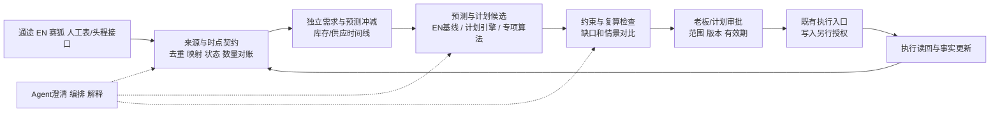

# 综合判断

本轮完成独立仓库盘点、三路公开资料研究、交叉审阅和部分既有代码离线测试。结论是研究判断，未由本公司数据回测或生产试用验证；尚未与 Claude/Cursor 的深度研究结果对照。

**建议先做“可追溯的计划建议闭环”，暂不选定大型平台。** 保留现有交易系统，复用已有归一/查询/出库采购桥/审批模式；先裁定需求、库存、完工与在途语义，再用相同数据比较 ERPNext 原生计划和增量计划引擎。AI 的职责由分任务的实验证据决定：可进入预测、澄清、异常归因、情景建模和解释，但所有计算/约束/动作都要可检验，生产写入仍遵守人工审批。

## 用户补充后的已定边界

历史需求预测已在未合并[PR #304](https://github.com/keyapi/fzh-data/pull/304)归档；阶段A完成，阶段B未启动。当前继承分段+全局LightGBM+Croston/TSB长尾/生命周期兜底+Conformal区间+物料组调和的方向。**现阶段不采用TSFM，SOTA研究不改变这一产品决定。** PB单SKU四方法是历史原型，不能当公司级模型或直接净补货；详见[历史接续](history-handoff.md)。

PJ/Jack头程资料尚在清理敏感内容、没有PR，用户后续提供；本研究先独立解决供应商数据获取、EN出库行关联、分批/拼柜与运输状态的底层模型，显示屏/下钻视图在其后，不受PJ现有实现约束。

头程补充结论见[数据接入](freight-connectors.md)与[关联模型](freight-model.md)：数据源可以是货代API/推送、船司标准接口、第三方聚合或版本化文件；内部先保存来源事件，再用DN行与运输批次/提单/设备/运输腿的显式分配关联。柜号、提单号、SO号各有作用，不能强行选一个万能主键；到港、清关、签收和可售入库也不是同一事件。规范/开源SDK能节省语义和校验实现，不能提供未签约的数据或自动知道我司货物归属。

| 为整体供应链补齐的头程能力 | 已有可复用/当前缺口 | 资料交付前可推进 |
|---|---|---|
| 获取与来源契约 | 钉钉只读表已存在；各货代接口/文件/账户覆盖未知 | 定义adapter边界、原文留存、分页/游标、失败与更新报告；不造假供应商字段 |
| 单据与货物关联 | 已有DN→通途采购桥；DN/提单/柜/票还需可追溯crosswalk | DN行、多票多柜、签发方命名空间、人工候选确认和版本化分配合同 |
| 多腿状态与事件修订 | 海运只是其中一腿；提货/场站/清关/末端来源可能不同 | 共享运输腿、planned/estimated/actual、发生/观察时间、迟到更正与幂等回放 |
| 数量与库存去重 | EN出库、通途采购在途、柜运输可能描述同一批货 | 同一supply_lot跨状态流转；分批到货/转仓后只计余量，不将各系统数量相加 |
| 仓库实收与可售 | 签收不证明点收齐全或可售，半成品可能要海外加工 | 原始收货行与DN分摊、gross/accepted/damaged、质检/加工/上架状态及数量单位 |
| 到货区间进入计划 | ETA不是可售日期，也可能多来源冲突/停更 | 分段提前期与数据新鲜度、未确定时情景区间；无足够标签不先建自有ETA模型 |
| 异常与人工处理 | 既有低库存/尾程通知可借输出方式，不能直接沿用业务规则 | 未匹配/超分配/少货/事件断流/ETA推迟队列，负责人、原因和回补，不静默丢弃 |
| 运费与运输策略 | 已有BOM头程费用口径，未证明真实批次运输成本或柜约束齐备 | 预估/实际费用分开并关联批次；装柜优化/重订舱等列后续，不因大框架而扩张当前实施 |
| 只读EN展示/下钻 | 已有EN内履约呈现测试产物，未包含头程闭环 | 从DN/SO追到关联票/腿/事件/原始证据；大屏可后接同一模型，先不另造展示平台 |

## 1. 对三个研究问题的直接回答

### 成熟架构有哪些可以借用

借用轻量 S&OP 的跨销售/供给/财务审批、时间相位净需求/BOM 展开、物料与产能约束、预测冲减、情景比较和执行反馈。月度评审、周度重算只是候选节奏，周期与冻结窗口应由业务确认。DDMRP/MEIO/APS 各自解决一部分问题，不是全公司应一起安装的菜单；详细证据和反例见 [industry.md](industry.md)。

**容易漏掉的一项成熟能力是预测冲减（forecast consumption）**：实际订单若已包含于同期预测，不能再将完整预测与实际订单直接相加。Oracle JD Edwards 官方说明支持按周期/客户冲减，见 [Understanding Forecast Consumption](https://docs.oracle.com/en/applications/jd-edwards/supply-chain-manufacturing/9.2/eoarp/understanding-forecast-consumption.html) 的开头及周期规则。本项目还要区分终端订单、内部补货 SO、调拨/采购和 BOM 组件需求：它们可能是同一终端需求沿供应链的不同表达，不是四份独立销量。具体冲减窗口、订单类型和客户/仓匹配须另定。

### AI/Agent 最新成果能承担什么

时序基础模型已具零样本、协变量或跨系列信息共享等可用方向；但公开平均榜单不能证明在本公司间歇、删失、多月跨度 SKU 上获胜。原始论文/公开基准、反证、权重许可与 Agent 案例分级见 [forecasting-agents.md](forecasting-agents.md) 和 [sources-ai.md](sources-ai.md)。不把 LLM、时序基础模型、概率预测器和约束求解器混为一种技术。

主 Agent 单独复核 [TimesFM 官方 README](https://github.com/google-research/timesfm) 的 2026-09 权重声明：代码及截至2.5权重的 Apache-2.0，不能套给3.0自托管权重；3.0下载权重非商业/非生产，授权云服务另有商用路径。版本、运行方式和预算都影响是否进入实验。

Agent 的可复用优势目前更明确地在多来源语义澄清、异常分流、工具编排和审批解释；其数值决策也可作为挑战者接受对照试验，不能因“模型会调用工具”就默认为可靠。源系统权限、schema、快照新鲜度、幂等和独立读回必须单独验证。现有 #288 的受控操作模式比新造通用浏览器 Agent 更贴近这类审批，但它是模拟场景，没有证明供应链生产可用。

### 哪些成熟/开源方案最值得验证

- **ERPNext 原生计划是必须保留的基线**：已有 SO/PP/WO/BOM/执行实体，先核实际部署版本与启用模块，避免在另一个系统再造交易事实。
- **frePPLe Community 是增量 APS 候选**，不是免费全套库存政策产品。官方 [Editions](https://frepple.com/editions/) 区分社区计划/统计预测与商业库存规划；[Inventory planning screen](https://frepple.com/docs/current/user-interface/plan-analysis/inventory-planning.html) 明确 Enterprise/Cloud 限制。正式 [9.19.0 CE release](https://github.com/frePPLe/frepple/releases/tag/9.19.0) 与滚动 current 文档版本必须分开核；不能把预览功能当稳定CE。
- **StatsForecast/Stockpyl/OR-Tools 等用于具体算法缺口**：有现成预测、库存模拟和求解工具，不能因此认为已有完整供需计划、审批和数据接口。
- **Odoo/WMS/BI/Agent框架各有位置**：替换 ERP、管理仓储、展示指标和编排工具是不同工作。当前没有充分理由再上第二个 ERP、重建 WMS 或先搭重型数据平台。保留商业补货产品作为购买对照，费用和适配未经报价核验，不默认自研更便宜。

更完整的候选、版本、许可、维护与TCO条件见 [open-source.md](open-source.md)。

## 2. 三条可比较路线

| 路线 | 做法/复用 | 何时适合 | 改变推荐的证据 |
|---|---|---|---|
| R-A 现有EN优先 | 只读快照/归一→统计基线→现有ERPNext计划实体/影子建议→一页审批；复用查询、映射与输出，不先接自动写入 | 计划约束简单，现有EN能表达关键BOM/时间与物料净需求，维护人手有限 | 若有限产能/跨仓供需/情景解释需大量定制，则升级R-B；如现有EN版本缺功能，不能假装已可直接运行 |
| R-B 增量计划引擎 | 共用事实契约→frePPLe正式CE影子计划；库存政策缺口用专项工具/报表或评估商业版，不替代现有ERP | 需要物料/产能/时间的统一计划、pegging/例外，且能维护物料/工序/日历 | CE库存政策/换型/交期承诺等edition边界、适配工程量与计划质量决定值不值得；无实际运行前不宣布胜出 |
| R-C 窄范围组件组合 | 共用事实契约→StatsForecast等预测→Stockpyl补货策略/OR-Tools窄问题→现有审批呈现 | R-A/R-B不能表达少数关键约束，或已有库已覆盖所需小问题 | 若发展为自行维护完整APS/权限/解释/恢复体系，TCO可能超过R-B或采购；停止通用平台扩张 |

路线并非三套并行建设。**先比较R-A与R-B的最小相同问题，R-C只补被实证的缺口。** 未获得人力/数据量/预算前不编价格、收益率或排期。软件许可费用、抽数/清洗、语义治理、运行维护、人工复核、失败处置和升级都计入TCO。

## 3. 四个数据边界先于框架选择

| 边界 | 本轮事实 | 必须保留的表示 |
|---|---|---|
| 需求单位 | 拆包裹实现已有，组件数量不等于成品需求；业务也可能单独卖皮壳 | 原始终端售卖SKU/件、包裹/部件行、规范产品映射与派生BOM需求分别记录；不能用Σ所有部件预测成品 |
| 库存位置 | 成本导入1000、报溢登记和EN/通途扣减边界各有历史记录 | 不同仓/状态/时点/用途的库存和预留；同一批货在EN DN、通途PO和头程不能重复加总 |
| 已生产 | 同ref旧代码首道量与新文档入库主口径冲突，成品可能无JC | 首道、末道去重、已提交入库、已出库分别存；显示差异，不把任一无校验字段直接升为可承诺库存 |
| 时间和可知性 | 下单/发货/结算月份不同，成本与ETA会迟到修正 | event_time、observed_at、effective_from/to与run_id；历史回测只使用当时能知道的内容 |

为每项“事实源”按字段、业务状态、仓/组织、时间范围裁定权威性，不强求整套系统全字段永远唯一权威。估算ETA、预测区间、人工确认不能改写成事实事件；无映射/不可信行保留并阻断对应建议，不静默补零。

## 4. 试点建议与老板的一页纸

试点选择不是直接锁PB：优先有已批准人工计划、可追溯销量/断货、清楚BOM/配套和采购/生产/头程的商品家族；PB 2026-10-16 是已知候选样例，但是否代表全业务、覆盖仓与渠道由业务确认。

先用同一计算快照给三种审批视角，避免先做一个不可验证的大屏：

| 视角 | 首屏回答 | 下钻证据 |
|---|---|---|
| 数量/交付 | 建议采购/生产/调拨多少，何时必须下达，保守/中性情景缺口何时出现 | 需求冲减、库存/在途、lead-time分段、MOQ/BOM与约束 |
| 资金/服务 | 不同方案现金占用、缺货/迟交风险、加急代价有什么取舍 | 成本来源/币种/日期、假设区间与Pareto情景；目标未定不伪造单一最优排序 |
| 异常/变更 | 较上次计划改了什么，哪些缺数或口径冲突需要谁决定 | 新订单/ETA/工序/库存变化、人工覆盖原因、责任人与未完成事项 |

每页共同包含范围、数据截止、已批准/本次建议差异、未匹配数、证据级别、人工覆盖与审批绑定的run_id。不用模型长篇描述取代数量/金额/证据。最终交付形态可为结论先行Excel、EN报表或轻Web；先让老板选择所需判断，再选UI。

## 5. 下一步验证与交接

详细通过条件见 [experiments.md](experiments.md)。先做无生产写入的契约玩具样例和真实脱敏快照回放；通过后才讨论部署/写回。三软件独立成果都固化后做对照，不用多数票选架构；差异表按主张/证据/适用条件裁决。

当前最需要业务/外部补充的四类信息：

1. 历史多方法预测已定位到#304及仓外PB输出；不再等待用户找位置，先按已归档原型和局限设计公司级读取层。
2. PJ/Jack头程接口仍未交付；供应商标识、访问授权、字段和更新契约等实现细节待后续。先独立研究可复用标准/接口和EN多对多关联，不等待或重复搭大屏。
3. 成品/皮壳单卖与配套单位、生产完工/入库口径、仓库可售/登记库存的现行定义。
4. 计划粒度、周期、资金/服务取舍、审批阈值与已批准样例；未答前继续资料与玩具数据验证，不扩大生产范围。

如用户选择 Astra 审查，先用以下问题审已有提交：

> 阅读本bundle的assets、coverage、synthesis、experiments及三路来源表。请找出会改变推荐的事实口径冲突、被漏掉的成熟整套方案、把营销/仿真外推的结论，以及哪个最小实验能最便宜地否定R-A或R-B。按严重性给证据与定位，不重新撰写一篇泛综述。
