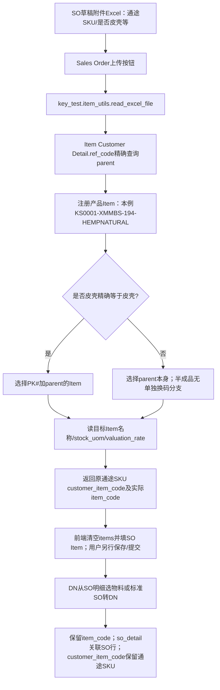

# EN SO Excel上传/下单映射：Agent共用常识

**已从生产代码、启用脚本配置、实际上传附件和SO/DN明细四路核实：下单输入是通途SKU，登记在EN产品Item的客户物料号；先以ref_code找到KS产品，再按上传形态选择实际SO Item。选皮壳后SO/DN出现PK#KS…是正常设计，不是映射错误，也不要求把通途SKU再登记一份到皮壳Item。**

**重要列名边界：用户口述的“备注（皮壳/成品/半成品）”，当前生产上传解析器技术字段实际叫Excel列`是否皮壳`。代码未找到读取`备注`列的分支，也未找到`备注→是否皮壳`预处理。** 两张真实SO附件表头也叫“是否皮壳”。本文保留用户业务语义，但不把未实现的列名别称写成已支持：新模板若仅有“备注”没有“是否皮壳”，不能假定会选择PK#。

已读[UOM-CANONICAL](reference/UOM-CANONICAL.md)：个/套分列；TJ#按套；PK#按皮壳1:1；未知单位不合计。

## 1. 生产入口：文件脚本为主，旧Client Script已停用

生产代码根目录：`/home/frappe/frappe-bench/apps/key_test/`。以下文件引用均相对此目录；DB脚本用`Client Script/<name>:脚本文本行号`定位，不伪造磁盘文件路径。

| 位置 | 核实结果 |
|---|---|
| `key_test/hooks.py:49-55` | doctype_js把Sales Order挂到`public/js/sales_order.js` |
| `key_test/public/js/sales_order.js:1-3` | 注释说明2026-10-10由旧Client Script迁入；不是仅凭注释判断，已查生产DB启用状态 |
| `sales_order.js:6-25` | 草稿docstatus=0显示按钮`custom_process_file_customer_item_code`；非草稿隐藏；读附件字段`custom_attach_file_customer_item_code`，调用`key_test.item_utils.read_excel_file(file_url,customer,customer_name)` |
| DB `Client Script/销售订单 子表 items 上传Excel  客户物料编号 转为 物料编号` | enabled=0；历史同名上传逻辑存在但不作为当前执行入口 |
| `key_test/item_utils.py:1268-1419` | 实际上传后端函数；读Excel、客户码→物料、皮壳前缀、属性取值及未匹配返回 |
| `sales_order.js:31-52` | **清空现有items再添加返回行**；不是增量追加/按SKU幂等merge；同一SKU多行不在此去重 |
| `sales_order.js:78-138` | 对限定三角物料组做“无扣”名称不一致橙色提醒；不是更改物料或硬阻断保存 |

生产Custom Field实际元数据：`custom_attach_file_customer_item_code`为Attach，标签Attach File Customer Item Code；`custom_process_file_customer_item_code`为Button，标签Process File Customer Item Code。业务显示翻译/按钮说明不能替代字段名定位。

上传前端只构造浏览器SO子表，未在这段回调中看到自动submit/后端创建SO；普通保存/提交仍走表单流程。**不能为只读查询点击该按钮**：它会清空/改写当前表单行。本文没有执行上传函数或按钮。

## 2. 上传列定义与实际映射

后端`pd.read_excel(full_file_path).fillna("")`（1289行）默认读第一工作表；未找到命名sheet选择/多sheet合并。以下“必有列”按`row[...]`读取判断，不代表代码有完整模板校验。

| Excel列名 | 读取位置 | 用法 |
|---|---|---|
| 通途SKU | 1301 | 必有；原值写customer_item_code并用作Item Customer Detail.ref_code精确条件；此处未见trim/大小写标准化/去删除前缀 |
| 数量 | 1302 | 必有；直接传qty；未见此函数独立校验负数/数值/整箱规则 |
| 标签组合 | 1303 | 必有；传custom_label_combination；不能把历史注释“标签验证”当作本函数已有完整验证 |
| 出货日期 | 1304-1305、1292-1296 | 必有；pd.to_datetime(errors=coerce).date()；未见完整非法日期拦截，NaT/异常结果不能当已证有效交期 |
| **是否皮壳** | 1306、1321-1322 | 可选、默认空、转str.strip；只有值精确为`皮壳`时选择PK#分支 |
| FBA SKU | 1307 | 可选；传custom_fba_sku，不替代通途SKU查物料 |
| 生产类型 / 生产方式 | 1308-1309、1280-1285 | 生产类型列优先，若列不存在才取生产方式；自制→In House、委外→Subcontract、物料需求→Material Request；其他值原样传，空则空 |
| 物料名称 | 1310 | 可选；传custom_tongtool_item_name供核对“无扣”等，不作为物料身份匹配键 |
| **备注** | 本函数未找到 | 不参与选码；不能把备注=皮壳理解成当前解析器一定读到皮壳 |

### 2.1 核心两步：先找注册产品，再决定订单形态

`item_utils.py:1317`：

```python
item_code = frappe.db.get_value(
    'Item Customer Detail',
    filters={'ref_code': customer_item_code}, fieldname='parent')
```

这里的parent是该客户物料号登记所属Item，本例为KS产品。再按1275–1278、1320–1322：

```text
prefix_mapping = {'皮壳':'PK#'}
search_item_code = parent_item
如果 strip(是否皮壳) == '皮壳': search_item_code = 'PK#' + parent_item
```

此上传函数虽收customer/customer_name，却**没有**用customer限制ref_code查找（它们用于FBA判定）。因此不能把“同一客户码已唯一”当成函数本身有歧义校验；多parent冲突须另查明。

| 形态单元格实际值 | 当前代码选择 | description前缀 |
|---|---|---|
| 皮壳 | PK# + 已找到parent | 皮壳 |
| 成品 | 已找到parent，不加前缀（本例KS） | 成品 |
| 半成品 | **没有半成品换码映射**，仍用已找到parent | 半成品（仅文本） |
| 空/缺列 | 已找到parent，不加前缀 | 默认成品 |
| 其他文本/“皮壳/成品”混写 | 不是精确皮壳就不加PK# | 文本原值 |

**所以“半成品”文字不保证SO Item已选半成品。** 若某客户码本来登记在半成品Item上则仍命中该parent；但这不是此列自动转换的成果。不要根据description反推实际item_code。

### 2.2 Item属性与回传SO Item

后端1326行从**最终选中Item**取`item_name/stock_uom/valuation_rate/description`，因此单位与名称来自PK#或KS本身，不从备注/发货形态猜单位。1334–1347返回数据，前端36–48行写SO Item：

```text
customer_item_code ← 原通途SKU
item_code          ← 最终search_item_code（或下面的截短兜底）
item_name/uom/rate  ← Item.item_name/stock_uom/valuation_rate
description        ← 碎海绵可选前缀 + 形态文本/默认成品 + Item.description
qty/custom_label_combination/delivery_date/custom_fba_sku/type_of_manufacturing
custom_tongtool_item_name ← 回传tongtool_item_name
```

`valuation_rate`是该代码取值，不等于已批准销售价/采购价，本文不建议用它审批成本。

### 2.3 真实存在的兜底与边界

- 最终物料不存在但编码含`-`时，1358–1384行会**去最后一个横杠片段**再查Item；成功就返回截短编码。这不是只生成候选，而是现有实现的真实fallback；研究/补货映射不得照抄为“已证完全相同”，必须核对是否丢色/属性。
- 没找到目标物料返回`item_code=None`和“没找到…物料”（1386–1397）；没有找到客户码parent时返回“通途SKU未登记或者登记错误”（1400–1412）。若空parent但选皮壳，拼出PK#None后也会走未找到目标分支，不保证提示准确区分根因。
- 异常1417–1419调用log_error并返回error对象；前端按item列表forEach处理，未见完整结构校验。**本次未调用该函数，避免错误日志等服务端副作用。**
- 没找到active导入分支按Product Bundle/BOM/描述智能选择形态；没有证据则标未找到，不能替它补一套“应该怎样”的算法。

## 3. 主流程图



图中省略了截短兜底，仅为主路径；未命中/错误分支见§2.3，不能静默丢弃。

## 4. 指定示例：已核对实际Excel、主数据、SO与DN

### 4.1 主数据

生产SELECT得到：

- `Item Customer Detail.ref_code = C/Linen-Natural-194-688-wow`，`parent = KS0001-XMMBS-194-HEMPNATURAL`，special_mark为空。
- KS主档：三角靠枕-新棉麻本色-194-麻本色，item_group=三角靠枕，stock_uom=个、is_stock_item=1、disabled=0。
- `PK#KS0001-XMMBS-194-HEMPNATURAL`确实存在，名称皮壳#三角靠枕-新棉麻本色-194-麻本色，组皮壳#三角靠枕，同为个、库存物料、未禁用。

### 4.2 实际上传附件

只读openpyxl读取已存在附件，未上传新文件：

- SO-26-00103的`custom_attach_file_customer_item_code=/private/files/EN系统订单模板f04de5.xlsx`；
- SO-26-00109为`/private/files/EN系统订单模板d6665f.xlsx`。

两份第一sheet原表头均为：`通途SKU / 物料名称 / 是否皮壳 / 标签组合 / 数量 / 出货日期`。示例客户码行的`是否皮壳=皮壳`，不是“备注”列。由代码及附件共同证明：

```text
输入通途SKU C/Linen-Natural-194-688-wow
→ 客户物料号登记parent KS0001-XMMBS-194-HEMPNATURAL
→ 业务备注/形态“皮壳”（实际Excel列：是否皮壳）
→ SO Item.item_code = PK#KS0001-XMMBS-194-HEMPNATURAL
→ SO Item.customer_item_code = C/Linen-Natural-194-688-wow
→ DN继续沿SO行选PK#物料，不重新根据通途码改回KS
```

### 4.3 已保存单据

| 单据/行 | 实际item_code、客户码与数量 |
|---|---|
| SO-26-00103 / 7of8o6jvj2 | PK#KS0001-XMMBS-194-HEMPNATURAL；通途客户码保留；qty320个；description为皮壳+皮壳物料描述 |
| SO-26-00109 / h9el67r6db | 同PK#及客户码，qty300个 |
| SO-26-00085 / 964j7q2c13 | 同PK#及客户码，qty150个 |
| DN-26-00064 / oe6va3a0k3 | PK#同物料，qty7个、docstatus1、posting_date2026-08-19，against_sales_order=SO-26-00085，so_detail=964j7q2c13 |
| 同DN / ta85pesl7n、8lqgcui3cc | 同SO行另两条16个、7个，说明一个so_detail能对应多个DN Item行，不能拿so_detail当DN行唯一键 |

这些是抽样单据，不把3条DN行当成该SKU全部历史发货。

## 5. DN如何承接SO物料（两条已定位路径）

### 5.1 生产启用的DN客户端选择器

DB `Client Script/销售出库 选物料 来自销售订单明细` enabled=1：

- 第3–5行创建“选择物料→从销售订单选择物料”。
- 第21–26行调用`key_test.sales_order_utils.get_sales_orders_with_items(customer=DN.customer)`。
- 后端`key_test/sales_order_utils.py:4-20`取当前客户有效已提交、未关闭等SO，再读其Item行；23–31行返回`name/item_code/customer_item_code/qty/delivered_qty`等。
- 客户端第80–87行：`DN.so_detail = SO Item.name`、`DN.item_code = SO Item.item_code`、`DN.qty = qty−delivered_qty`、`against_sales_order = SO.name`、`customer_item_code = 原SO客户码`；标签也保留。

**这里没有把KS“变成”PK#：形态通常已在SO上传时选好，DN复制的是SO行实际物料。** 此选择器不代表所有DN只能经此入口生成，仍须用行外键查实际血缘。

### 5.2 ERPNext标准SO转DN

生产代码`apps/erpnext/erpnext/selling/doctype/sales_order/sales_order.py:917`的make_delivery_note；984行取剩余qty，996–1009行将Sales Order Item映成Delivery Note Item，其中`name→so_detail`、`parent→against_sales_order`。没有在这段建立根据“备注”再次推断皮壳的规则；保留SO选定物料是主逻辑。

另查到启用脚本“销售出库 创建 物料移动 直接调拨发货 国外在途仓”，其DN items按item_code/qty/uom构造移动参数；这不证明目的仓已真实收货。本任务不运行这些按钮/脚本。

## 6. 海绵、内胆、半成品与套件：已找到/未找到分开

### 6.1 碎海绵：FBA客户+客户码特殊标记，只加文字

`item_utils.py:1272-1273`：SO customer或customer_name包含FBA（转大写判断）；1313取`Item Customer Detail.special_mark`，1314只有FBA且special_mark精确“碎海绵”才加“碎海绵 ”前缀。

该前缀加入description和tongtool_item_name（1331/1346、1367/1382）；**没有改变item_code、qty、uom或BOM**。非FBA即便有special_mark也不加此文本。`FBA SKU`独立字段不是物料lookup入口。未找到上传器自动把普通SKU变海绵-Foam、碎海绵BOM或不同数量换算的分支；若客户码映射parent本就是某海绵Item，沿一般parent规则，不是一个特殊换码算法。

### 6.2 配套内胆：另外一个按钮，不是上传自动展开

生产启用 `Client Script/销售订单 子表 items 所有行 增加配套物料20241030`：第5行是独立“为所有行增加配套物料”按钮；31–48逐行调用get_supporting_item；95行数量ceil(row.qty×coefficient)，103–108加新Item行，**没有填customer_item_code**，所以配套内胆行缺通途客户码不必然是上传映射失败。第65–71行还含frm.save/clear_cache，不能在只读核查点击。

`item_utils.py:743-746`按产品/半成品物料组树分类；760–852的get_supporting_item：半成品组走“内胆#”配套，成品组直接return None（783–787）；取尺寸属性（797–804），配套组可被`custom_replaced_by_other_item_group`替代（814–823），仅取未禁用/非模板物料，再按同尺寸挑选（827–847）。可返回多个匹配物料，并非唯一BOM自动齐套证明。当前内胆系数1.0；不能把这个按钮的潜在结果当成每张SO都已执行。

### 6.3 半成品：上传列只有文字效果，真实身份看parent/Item

如§2，prefix_mapping只含皮壳，未找到“半成品→某前缀”分支。get_supporting_item的半成品判断来自Item Group树，和上传列字符串不是同一个判断。不要把“备注=半成品”当已证物料转换，也不要把SO配套内胆当新终端需求。

### 6.4 TJ#套件：标准Product Bundle，不是PK#前缀规则

在key_test的read_excel_file及其当前上传JS**未找到TJ#/套件专门展开逻辑**；本次检索key_test Python/JS中的Product Bundle命中主要是物料反向关联查询，并非SO上传特殊处理。

已核实生产主数据：`TJ#KS0001x1_KS0260x1-001`为套件、stock_uom=套、is_stock_item=0；有效Product Bundle.new_item_code同名，组件KS0001-DM-100-YELLOW×1个与KS0260-DM-50-YELLOW×1个。

真正展开路径在生产ERPNext标准代码：

- `selling/doctype/sales_order/sales_order.py:219-221` validate调用make_packing_list；
- `stock/doctype/packed_item/packed_item.py:57-93`按有效Product Bundle识别并逐组件生成packed_items；135–152按new_item_code读取Bundle Item；
- 同文件199–205：parent_item/parent_detail_docname保留父项血缘，组件qty=packing_item.qty×main_item_row.stock_qty。

因此只有已登记且有效的Bundle才走此路径，不是任意带TJ#文字就能证明组合内容。若通途客户码确实登记在TJ# Item上且不走皮壳前缀，一般上传路径可选到该父Item；本次未找到/未实际验证“该套件通途码上传→SO保存→DN出库”的完整样本，不能宣称所有套件上传都已端到端通过。**严禁给TJ#机械加PK#，也不得把套件套数和packed_items组件个数相加。**

## 7. 手工客户码输入与Excel上传不是完全相同实现

生产启用`Client Script/销售订单 客户物料编号 带出 内部物料编号`：第1–14行监听SO Item.customer_item_code变化，用Item子表过滤`customer_name=SO.customer`和ref_code，再set item_code。

它和上传函数的差异：手工字段事件加客户条件；上传后端仅按ref_code找parent，再按是否皮壳选PK#。**不要用手动录入的逻辑解释上传，也不要断言手工重填客户码后一定还保留PK#。** 本次只读代码，没有在浏览器模拟事件触发顺序/表单保存，所以手工编辑与上传后可能相互覆盖的运行时行为标未验证。

## 8. 所有Agent必须遵守的五条规则

1. **先找客户码登记产品，再区分订单实物形态。** 通途SKU在EN产品Item.customer_items.ref_code；保留原通途码、注册parent与实际SO/DN Item三个字段，不要求皮壳/内胆重复登记客户码，不因DN是PK#就判错。
2. **形态选择以真实上传列与代码为证。** 当前技术列名是否皮壳，精确皮壳→PK#+parent；成品/空默认parent；半成品不自动转换；备注列别名未找到。不能偷偷改模板、把备注文字当已证物料身份或给套件/海绵乱加前缀。
3. **追溯用行级外键，DN承接实际SO Item。** SO Item.name↔DN Item.so_detail、SO.name↔against_sales_order；DN Item.name自身才是出库行ID；多DN行可指同一SO行。客户码可缺，不能只靠客户码/描述/前缀猜关联。
4. **PK#、内胆、海绵、TJ#及UOM各守边界。** PK#是皮壳1:1代理、不是套；内胆是配套组件；碎海绵标记在此只改文本；TJ#有效Bundle按套且组件另列，不与父量双计；未知单位不合计，形态不反推单位。
5. **已有代码的宽松fallback不是审核真值，也不是只读工具。** ref_code多parent、截短物料、空item、非法数量/日期都需补证，保留原码/候选/源行，禁止无声取首个。只读调研不运行上传/配套/出库移动按钮，不调用可能记日志或保存的处理方法、不改EN；先读生产版本与enabled状态，发现未支持的分支明确写未找到。

## 9. 版本、哈希与只读审计

2026-10-29通过SSH别名“阿里云-FZH-ERPNext-frappe”只读查看生产源码与SELECT查询；key_test HEAD=`d29becf63b34338d38174de7dd48cf418c9d52cc`，前后git status --short均空。未读取/输出凭证值。

| 源 | SHA256 |
|---|---|
| key_test/public/js/sales_order.js | b02ba310774ead39bc6bee2bdbfd0da67ff5d768dd59fd9d5deef9cdfd68c457 |
| key_test/item_utils.py | 6eae274980ac7b663eb28ef53399dd061337cdb7154ce01c92994a62a197b288 |
| key_test/sales_order_utils.py | c20cebf827466ac5f9f13093856dae8a8491f5fa95bd9e7c0ccf48cf448ee75e |
| key_test/hooks.py | 4b2be780072845dc339574025ae5b71dcb007629bb644bb226ceb34b680ad70b |
| DB Client Script：所有行增加配套物料20241030（完整script UTF-8文本） | eae663c9b66f322013620297d3a0bb9e4799248558b95a84bb740948d9fdd763 |
| DB Client Script：销售出库选物料来自销售订单明细（完整script UTF-8文本） | 5ee5ec2170ea8a3e0d72b7d805c9493d94012cd9d2ee41163d350d2aa406ed6c |

DB查询只使用SELECT：Client Script启用及script、Custom Field、Item Customer Detail、Item、Sales Order/Item、DN/Item、Product Bundle/Item；已有Excel用openpyxl read_only=True读取第一sheet表头及指定SKU的形态值。远端Python使用-B；未执行read_excel_file/get_supporting_item、未启动Frappe写方法、未上传/保存/提交/改脚本/清缓存/部署/重启/改库存、未push。只新增用户指定本参考文件；未修改既有事实规范或索引。

本文记录的是当日生产实现与抽样证据，不表示现有上传器已经具备严格映射去歧义、数量守恒校验或所有特殊物料自动适配。后续Agent按上表commit/hash与DB enabled复核漂移；旧注释/旧Client Script不得覆盖生产启用路径。