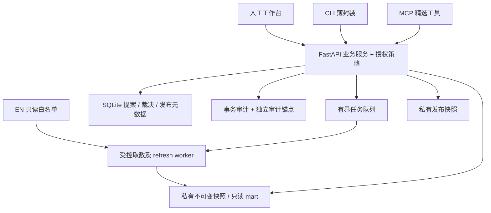

# 补货需求协同的 Agent 数据接口

研究日期：2026-11-24。范围：研究与设计；不改业务代码、不访问生产数据、不部署、不下单、不写 EN 业务数据。文中接口名与数值限制均为建议，除非明确标为已验证事实。

## 1. 决策与证据等级

**建议：REST/OpenAPI 是业务契约，MCP 是任务适配，CLI 是批处理入口，语义层是共同语言，快照/mart 是大量明细的载体。** 不应让任意 SQL 或通用 ERP CRUD 承担提案、审批、发布。Agent 可查询、重算、提交判断；审批及发布由经过独立认证的人完成，发布仍只是需求场景快照，不产生采购资格。

本报告的“SOTA”指截至研究日从官方资料可验证的成熟设计模式与代表性实现，不是性能排名或已完成本项目生产验收。所有开源组件均只做文档评估，未安装或运行；没有证据支持其在本项目规模下的延迟、吞吐与准确率承诺。

| 标记 | 含义与边界 |
|---|---|
| 本地事实 L | 读取 Git 中源码/文档确认；不代表已部署 |
| 外部事实 F | 官方规范、维护方文档或仓库说明；来源见文内链接及末尾目录 |
| 建议 R | 针对本项目的架构推断；需要实施验收 |
| 未核实 U | 生产版本、真实配置或兼容性未检查；不得当作现状 |

### 本地资产核对（L）

当前研究工作树不含 `demand_collaboration/` 与 `supply_copilot/`。通过 `git show feature/supply-copilot-release:<path>` 读取，固定证据提交为 `666cd700adb2bc187d30c1de13a1e563314bea40`（2026-11-23）；没有切换或修改该分支。

| 源码位置（上述提交） | 已确认事实 | 设计含义（R） |
|---|---|---|
| `demand_collaboration/web.py:create_app` | FastAPI，身份来自服务端 actor/role；loopback/TrustedHost；端点包括 state、recommendations、proposals、decision、publish、publication download；请求多为 dict | 固定本地身份不是多人鉴权，不能直接公网暴露或全量生成 MCP |
| `core.py:Store.submit/decide/publish` | 提交 ID+内容/作者 hash 幂等，异内容返回 409；revision 乐观并发；reviewer 限制及禁止自批；同范围批准重叠检查；写操作与 audit 记录在 SQLite 事务内 | 复用 Store 语义；HTTP 幂等规范、身份授权与范围校验在其外围补齐 |
| `core.py:Store.state`、`web.py:/api/state` | state 含 baseline/proposals/publications/audit；recommendation 另经 filter_snapshot；未见所有对象统一行级过滤 | 不能把只过滤 recommendation 等同于整体隔离；state 与下载是必须覆盖的泄漏面 |
| `recommendation.py`、`so_evidence.py`、`AGENT_HANDOFF.md` | 未知值 None；输入=接收+拒收+跳过；商品×分公司×源期间语义；SO 近期/历史开放/日期未知分段；SO 未加入建议量 | 语义契约优先于工具便利；历史开放余额不可静默丢弃 |
| `live_stock.py`、`web.py:with_live` | 实时库存只装饰读视图，不回写冻结快照；失败标 stale/unavailable | 实时 overlay 与快照分别标时间、hash，不能称为同一时点的事实 |
| `frappe_bridge.py` | 用 Frappe session.user，拒绝客户端身份字段；Demand Contributor/Reviewer/System Manager 分工；导入基准需 System Manager | 可复用业务角色思想，但不扩大 Agent 的 EN 角色 |
| `supply_copilot/cli.py`、`paths.py`、`download.py` | doctor/pull/recommend/batch/refresh；recommend 默认完整、limit 显式；refresh 要 branch+sku；manifest/as_of 与包下载校验已有入口 | batch 是现有离线汇总，不等于整分公司实时 refresh；CLI 暂无统一 API 错误/鉴权契约 |

背景中 EN 的 `supply_facts/live_stock/get_html` 白名单与 System Manager 限制作为任务给定资产；本轮未连接 EN 核验其部署状态（U）。`frappe_bridge` 是另一层协同接口，不能据其角色表推断所有 EN 白名单都可供普通 Agent 使用。

## 2. 五种接口形态如何组合

| 形态 | 大量明细 | 筛选/聚合 | 提案 | 审批/发布 | 本项目判断（R） |
|---|---|---|---|---|---|
| REST + OpenAPI | 游标分页/异步导出 | 类型化查询与指标端点 | 最合适：领域命令、幂等、事务 | 适合：服务端校验人工授权 | 主业务边界；UI、CLI、MCP 共用 |
| MCP | 返回页或授权资源引用；不把整包塞入上下文 | 任务级工具，先汇总后钻取 | 少量显式写工具 | 协议本身不替代业务审批 | 适配客户端工具发现与调用，不再建一套规则 |
| CLI | 最适合私有文件批处理/流式 JSONL/Parquet | 稳定 flags、JSON 输出、管道 | 可调用同一 API | MVP 仅人工入口，机器凭证不获审批权 | 复用 supply_copilot 与离线回放优势 |
| NL2SQL/Text-to-SQL | 结果仍需配额/导出 | 适合临时分析；join/期间/NULL 易出错 | 不适合通用 SQL 写 | 不允许 SQL 绕过状态机 | 后续分析沙盒；MVP 用参数化语义查询 |
| 数据目录/语义层 | 描述数据集及授权下载 | 固化粒度、度量、join 与证据 | 描述提案语义，不执行变更 | 不能单独提供审批机制 | MVP 先字段字典+查询模板，无需立即引入平台 |

**2026 年代表实践（F）：** FastAPI 以 OpenAPI/JSON Schema 与 Pydantic 提供契约；MCP 工具支持输入/输出 schema 和结构化结果。FastMCP 官方建议对复杂 API 策划工具，自动转换主要适合起步，不能从“可生成”推导“好用”。[FastAPI](https://fastapi.tiangolo.com/features/)、[MCP Tools](https://modelcontextprotocol.io/specification/2026-07-28/server/tools)、[FastMCP OpenAPI](https://gofastmcp.com/docs/integrations/openapi)。

语义查询已有实用产品：dbt MCP 连接元数据、指标与受控工具；Snowflake Cortex Analyst 使用语义视图和已验证查询示例辅助 NL2SQL，当前文档建议向 Cortex Agents 迁移。这支持“先治理语义再让 Agent 查询”的方向，不能证明本项目直接接裸表可得到正确补货量。[dbt MCP](https://docs.getdbt.com/docs/dbt-ai/about-mcp)、[Cortex Analyst](https://docs.snowflake.com/en/user-guide/snowflake-cortex/cortex-analyst)。

典型执行链（R）：`catalog → query_recommendations(branch, period, snapshot) → aggregate → get_evidence(row_ids) → submit_proposals(batch)`；人工审阅差异后 `decision → publish`。整分公司由一次任务创建覆盖全范围，不要求人或模型逐个 SKU 点网页。

## 3. 推荐分层与读写边界



### 数据面（R）

- 保留 manifest/pack/as_of/hash；推荐快照与事实快照分开。快照不可变，live overlay 独立存 `stock_run_id/observed_at/fetched_at/status`。查询默认钉住 snapshot_id；若选择实时模式则显式标出混合时点。
- SQLite 当前承担协同状态与轻量只读查询即可；读写分连接、分析用快照副本/只读文件，文件由服务持有，不把数据库路径给 Agent。大规模列式扫描出现实测瓶颈后再引 DuckDB + Parquet；多用户写争用、权限隔离与恢复需求超出 SQLite 后再评估 PostgreSQL，不预先重写。
- 建维度/事实与显式桥表：商品、SKU 别名、分公司、仓、客户、形态、UOM、期间、事实源行；标注映射的一对多关系及有效期。SKU 不能代替业务行主键；别名多匹配必须返回 ambiguous，不任意选第一条。
- 期间保持源开始/结束、闭区间、源时区及源窗口含义。库存是时点量，不跨日期求和；total/delta/percent/event_only 不混加；未知不补 0。聚合同时返回 known_count/unknown_count 与 completeness，缺失影响总量时结果标 incomplete，不能把 SQL SUM 跳过 NULL 后称为完整需求。

### 业务面（R）

业务函数为唯一状态转换入口，新增 Pydantic 请求/响应 DTO；原有 Store 继续维护期间、重叠、revision、资格限制。REST、CLI、MCP 都调用同一服务与策略检查。refresh 只写新的本地分析产物；proposal/decision/publication 只写协同库；EN 集成账号没有业务写权限。发布不是发送通知或下单，不隐含任何外部执行。

建议接口目录（全部为未来设计；不是现存端点清单）：

| REST | MCP | 作用及授权 |
|---|---|---|
| `GET /api/v1/catalog` | `describe_supply_data` | 授权范围内 schema、语义、数据新鲜度 |
| `POST /api/v1/queries/recommendations` | `query_recommendations` | 固定查询模型；允许列/filters/group_by 白名单，无任意 SQL |
| `POST /api/v1/queries/evidence` | `get_supply_evidence` | 批量 row_ids 或精确 SKU+分公司+期间，返回分页证据链 |
| `POST /api/v1/refresh-jobs`、`GET /api/v1/jobs/{id}` | `start_branch_refresh`、`get_job` | 冻结范围清单，一次作业涵盖分公司，返回 job_id；不产生提案或审批 |
| `POST /api/v1/proposal-batches` | `submit_proposals` | 单条也走同一契约；只允许当前主体范围 |
| `POST /api/v1/proposals/{id}/decision` | MVP 不向机器暴露 | 人工 reviewer；理由、版本与审阅内容绑定 |
| `POST /api/v1/publications` | MVP 不向机器暴露 | 人工 publisher；显式选定范围/基准/已批准集合 |
| `GET /api/v1/publications/{id}`、`.../download` | `get_publication` | 读也校验范围与字段权限，不凭 hash 获得访问权 |

CLI 未来远程模式复用 API；离线 recommend 保留为纯计算/回放路径，明确 `mode=offline`，不得离线批准。建议 `--json/--jsonl/--cursor/--output`、稳定退出码、stdout 只放机器结果，stderr 放进度；不把 token 放命令行参数，不提供任意 shell/任意 RPC 的 MCP 工具。

## 4. Agent 可操作的契约（R）

| 主题 | 最小约定 |
|---|---|
| schema/类型 | schema_version；严格枚举、有限数值、禁止额外字段；数量带 UOM，金额为 decimal 字符串+币种；日期与带时区时间戳分开；NULL 带 missing_reason。字段写明“待发不是已关联订单”“建议不是订单” |
| 稳定 ID | product_id 与别名分开；scope_key 含商品/分公司/仓/客户/形态/UOM/源期间；row_id 绑定 snapshot_id+scope_key；source_id 与 source_row_id 贯通。重新生成内容 hash 不替代跨快照的业务键 |
| 筛选/聚合 | 精确 SKU 默认；模糊匹配显式且先消歧；branch/期间/snapshot 必填或由已授权保存视图确定。允许 group_by/metric 组合白名单；限制 join 粒度，返回 applied_filters、metric_version、query_hash |
| 分页 | 建议默认 100、最多 500 行/页；冻结快照上按稳定 row_id keyset 排序；opaque cursor 绑定主体、策略版本、snapshot、filters 和过期时间。越权/过期游标拒绝；总数仅计算授权范围 |
| 批量 | 建议最多 100 条提案/批；每行 client_row_id、status、code。业务校验可部分接收并完整报告；鉴权失败整批拒绝。input=accepted+rejected+skipped，重复键/冲突/缺证据不丢弃；refresh 的 SKU 列表由服务按权限展开并冻结 |
| 幂等 | 复用提交 ID 语义；额外统一 Idempotency-Key，唯一范围为主体+操作+键，保存规范化 payload hash 与响应；相同重试返回原结果，异内容 409。基准、snapshot、期间、算法版本纳入 hash；批次重试不得重复落行或重复成功事件 |
| 并发 | expected_revision/ETag；陈旧基准或修订返回 409/412；批准和发布在事务内再次读版本/重叠/权限；不能只靠 MCP 确认对话 |
| 错误 | REST 参考 RFC 9457，type/title/status/detail/instance，扩展 code/request_id/retryable/field_errors；不泄漏 SQL、凭证与私有路径。MCP 业务失败用 isError 与同一错误对象，协议错误另按 JSON-RPC；CLI 相同 code+非零退出 |
| 配额 | 按主体+分公司限并发/扫描预算，建议每主体 2 个 refresh；429 带 Retry-After，瞬时 5xx 有界退避；参数/权限/期间错误不自动重试；refresh 批量取库存并缓存相同 run，不每 SKU 重拉全仓 |
| 大结果 | 建议内联预算 256 KiB，超限返回下一游标或异步 export_id；返回 returned_count/matched_count/has_more/truncated/原因，聚合覆盖全授权集合而非第一页。授权下载 JSONL/Parquet，hash+行数校验，链接短效且重新鉴权 |

数值上限为启动配置建议，实施时用合成 10,000 行与典型私有负载测定。MCP 的工具发现分页不等于业务结果分页；两者必须独立设计。结构化结果与 Pydantic schema 提供语法检查，不能自动证明领域语义正确。[Pydantic JSON Schema](https://docs.pydantic.dev/latest/concepts/json_schema/)、[Problem Details RFC 9457](https://www.rfc-editor.org/rfc/rfc9457.html)。

### 证据响应示例（合成；R）

```json
{
  "schema_version": "supply-evidence/v1",
  "snapshot_id": "synthetic-snapshot-01",
  "row_id": "synthetic-row-01",
  "scope": {"product_id": "EXAMPLE-001", "branch": "EXAMPLE-BRANCH", "unit": "piece"},
  "period": {"start": "2026-11-01", "end": "2026-11-30", "bounds": "inclusive"},
  "inventory": {"quantity": null, "status": "unavailable", "missing_reason": "source_unavailable"},
  "source_refs": [{"source_id": "synthetic-source", "source_row_id": "line-1"}],
  "service_certified": false,
  "replenishment_eligible": false,
  "page": {"returned_count": 1, "has_more": false, "next_cursor": null}
}
```

## 5. 权限、人工边界与审计

### 规范现状（F）

已检查 MCP **2026-07-28** 授权规范：HTTP 授权采用 OAuth 体系，MCP server 是资源服务器；规范仍允许不实现授权，但本项目应强制认证。规范要求资源元数据发现和受众验证；OIDC 可用于身份/发现，不能把 ID token 当 API access token。stdio 使用环境凭证，不能据此推断多人身份；动态客户端注册在本版已弃用并保留兼容，CIMD 为推荐支持方向。[MCP Authorization](https://modelcontextprotocol.io/specification/2026-07-28/basic/authorization)。

官方安全文档明确涉及 token passthrough、confused deputy、SSRF、会话劫持、stdio 代理等风险；工具的 readOnly/destructive 等注解不是可信授权边界。仅隐藏 tools/list、提示“请勿写入”或让模型自报 actor 均不能阻止直接调用。[MCP Security](https://modelcontextprotocol.io/docs/2026-07-28/tutorials/security/security_best_practices)、[MCP Tools](https://modelcontextprotocol.io/specification/2026-07-28/server/tools)。

### 项目权限模型（R）

**每请求校验有效 access token + 操作 scope + 服务端人员/商品/分公司授权关系；所有入口共用默认拒绝策略，审批凭证与 Agent 凭证分离。**

- 人：OIDC 登录，授权码+PKCE；校验 issuer/audience/expiry/signature，主体来自验证结果。服务账号：独立机器身份、短期凭证、限定分公司与读取/重算/提案权，不能复用 System Manager。若采用 OAuth client_credentials，必须验证授权服务器与目标 MCP 客户端的扩展兼容性（U），不能当作所有 MCP 宿主已支持。
- scope 建议 `supply:read`、`evidence:read`、`refresh:run`、`proposal:write`、`decision:write`、`publication:write`。scope 只表达动作，行级关系与 cost/customer 等字段级许可由服务端表决定；机器账号后两项不授予。范围缺失拒绝，客户端 branch 只是请求筛选，不能扩权。
- 鉴权先于查询、聚合、缓存命中、导出与错误细节。缓存键包括主体/授权版本/字段许可，权限收回后旧游标及下载不可继续使用。证据引用、作业状态、publication/audit 也不能旁路；默认不允许任意文件路径、外链 URL 或 RPC 方法名。
- SQLite 的服务层统一授权加文件 ACL 是当前隔离边界；不同授权主体不能直接读同一个全量 DB/pack。服务下载按范围生成包，已下载私有文件无法通过 token 撤销追回，因此需限制生命周期与终端访问。后续 PostgreSQL 可加 RLS 防御，连接角色不得是 owner/superuser/BYPASSRLS；数据库权限不能只靠 SQL 字符串分类器。[PostgreSQL RLS](https://www.postgresql.org/docs/current/ddl-rowsecurity.html)。
- MCP→业务服务应在可信边界内传递经过验证的主体上下文；若拆成不同资源服务器，用面向下游的凭证/经验证的授权委托，不能把 MCP token 原样转给 EN。EN 凭证只驻留受控取数服务，拒绝 Agent 任意指定后端地址。
- 人工审批查看明确基准、源期间、改前/改后、理由与证据。服务端保存审阅 nonce/approval_id，绑定 reviewer、实体 revision、内容 hash、范围与过期时间；内容变动使批准失效，防重放。提交者不得自批；Agent 不能用写工具生成“人工已批准”字段。发布需要独立人工确认清单与 hash，事务内校验批准集合仍有效。

### 审计与防篡改分级（R）

复用现有事务 audit，扩展 event_id、request_id、actor_sub、client_id、代理/人工类型、action、entity+revision、scope、payload_hash、before/after hash、snapshot/算法版本、reason、decision、UTC 时间、policy_version。理由与证据原文放受控私有存储；公开日志不记录客户、成本或 token。读/导出与拒绝事件也记录，但失败审计不得随业务回滚消失。

MVP 采用“状态+同事务追加事件”，不要求改成完整事件溯源。禁止业务身份 UPDATE/DELETE audit，唯一幂等约束与审计写入原子化；发布记录含批准提案版本、源快照、计算版本和结果 hash，可重放核对。

**不能称现有 SQLite audit 不可篡改。** 同一管理员能改数据库和 hash 链；hash 链只能检测有锚点的改动。需要独立权限域的签名检查点/追加式外部审计或 WORM 保留后，才能提高抗篡改保证；记录 retention、访问策略和校验结果，先明确威胁模型再选实现。OpenLineage 记录 dataset/job/run 血缘，不能代替谁批准了什么的业务审计。

## 6. 开源与产品方案盘点

以下“适用/暂缓”均为 R；能力与维护状态为 F（维护方资料，访问日同本报告）。不把星数或 README 声明当作生产认证。

| 方案与来源 | 可验证能力/状态 | 本项目适用性与边界 |
|---|---|---|
| [tadata FastAPI-MCP](https://github.com/tadata-org/fastapi_mcp) | FastAPI 端点转工具，保留 schema，复用 Depends 鉴权，ASGI 集成，MIT | 只读端点白名单原型优先候选；不能自动补齐当前 dict schema、行级授权或人工门 |
| [FastMCP OpenAPI](https://gofastmcp.com/docs/integrations/openapi) | OpenAPI 生成及 RouteMap 排除；维护方建议复杂 API 用精选工具 | 与 FastAPI-MCP 二选一做短 PoC；MVP 手选任务工具，不能同时维护两套 schema |
| [MotherDuck/DuckDB MCP](https://github.com/motherduckdb/mcp-server-motherduck) | SQL、表/列发现；行数与字符数限制；明确警告只读仍可能访问文件/设置 | 私有离线分析候选；需锁扩展、外部访问、路径和资源预算，不直接连接业务协同库 |
| [DBHub](https://github.com/bytebase/dbhub) | Postgres/SQLite 等多库；schema 探索、受限 SQL、自定义参数化工具、超时 | 后续只读 mart 沙盒候选，不承载审批。官方 [2026 安全公告](https://github.com/bytebase/dbhub/security/advisories/GHSA-mwwr-p57h-56pf) 指出旧版只读绕过，修复版 0.22.6；选型须检查全部后续公告并固定安全版本 |
| [MCP PostgreSQL reference](https://github.com/modelcontextprotocol/servers-archived/tree/main/src/postgres) | 只读事务+schema；已归档 | 可读实现，不新装作生产方案 |
| [MCP SQLite reference](https://github.com/modelcontextprotocol/servers-archived/tree/main/src/sqlite) | 已归档，包含 write_query/create_table | 不因名字是 SQLite 就视为只读；不接现有协同状态库 |
| [MCP Filesystem](https://github.com/modelcontextprotocol/servers/blob/main/src/filesystem/README.md) | 可配置目录，包含读写/移动/编辑能力，非天然只读 | 只读快照下载最好走授权 artifact API；如用于本地必须工具白名单+OS 只读挂载，不开放整个工作目录 |
| [Frappe 内置 MCP/frappectl](https://docs.frappe.io/framework/guides-integration/mcp) | 官方 v16+，`/api/v2/mcp`，按登录用户权限，工具含 CRUD 与白名单方法调用 | 生产 EN 版本/开关未核实，不为用 MCP 升级或部署；不向 Agent 暴露通用写/submit/cancel |
| [frappe/mcp](https://github.com/frappe/mcp) | 2026-10-27 归档，官方说明已弃用、改用框架内置 | 排除旧插件新部署；文档中旧 OAuth 兼容提示不等于本项目已兼容新规范 |
| [muthanii/frappe_mcp](https://github.com/muthanii/frappe_mcp) | 社区 REST 代理，CRUD/方法调用，API key+secret | 适配参考；共享高权限 key 风险大，需逐工具削权与版本验证，MVP 不采用通用代理 |
| [OpenLineage](https://openlineage.io/docs/) / [Marquez](https://marquezproject.ai/) | job/run/dataset 及 facets；Marquez 为采集、存储、可视化血缘参考后端 | 先在 manifest 对齐 run/input/output/hash 概念；多管道追踪形成需求再上后端；不是审批审计库 |
| [Superset](https://superset.apache.org/docs/security/securing_superset/) | 分析展示；官方强调不是 DB firewall，建议独立最小权限数据库用户 | 人工只读分析面可选；关闭非必要 SQL/公开分享，只连范围化 mart，不绕业务服务写库 |
| [Metabase](https://www.metabase.com/docs/latest/permissions/row-and-column-security) | 易用分析面；行列安全为 Pro/Enterprise；SQL 结果和公开分享有隔离限制 | OSS 不能假设自带所需行级隔离；如选用须靠受限视图/数据库角色并验证分享路径 |
| [MetricFlow](https://github.com/dbt-labs/metricflow) / [dbt Semantic Layer](https://docs.getdbt.com/docs/use-dbt-semantic-layer/dbt-sl) | MetricFlow 生成指标 SQL；0.209.0+ Apache-2.0；托管 Semantic Layer 有账号/套餐要求 | 字典先行，后续复杂 join/指标复用再评估 dbt；不能把托管权限服务误称为免费开源引擎 |
| [Pydantic](https://docs.pydantic.dev/latest/concepts/json_schema/) | Python 类型校验和 JSON Schema 生成 | 直接复用；约束 NULL、枚举、期间与响应契约，域规则仍由 Store/服务实现 |

NL2SQL 后续准入（R）：仅允许脱敏/范围化 mart 的 SELECT 模板或经受限执行器检查的 AST；数据库账号/只读文件本身不能写；禁多语句、扩展加载、外部文件/网络/危险函数，设时间与扫描预算。建立领域金标查询集，覆盖期间重叠、库存时点、重复映射、单位转换与未知；返回 SQL/参数、口径版本和可追溯证据，无法确定的概念先拒绝消歧，不猜。只检查首词 SELECT 远远不够。

## 7. MVP 任务清单与验收

这些是下一轮实施任务，本轮未执行。先交付 1–3，再接通 4–6，最后验证 7–8；不要求先装 BI、Marquez、dbt 或迁移数据库。

| 顺序 | 任务 | 可判定验收（全部使用合成/授权私有夹具） |
|---|---|---|
| 1 | 建统一 DTO、语义目录和快照证据查询 | SKU+分公司+精确期间可还原源行→推荐→SO 分段→库存 run→提案→发布引用；无映射/歧义明确返回；未知为 null；total/delta/期间不混淆，采购与认证资格恒 false |
| 2 | 统一身份与行/列权限 | 两人/两分公司及机器账号矩阵；跨范围读、聚合、state、证据、job、audit、download、直接工具调用均拒绝或仅返回授权集合；伪造 actor/role、过期/错 audience token 无效；成本列另控；权限撤回使旧游标失效 |
| 3 | 提案批量幂等与审计原子性 | 相同键同内容并发重试只一条提案及一次成功事件；异内容 409；100 行混合合法/重复/错期间全部有行级结果且数量守恒；中途失败不出现提案有记录而审计无记录；身份由服务决定 |
| 4 | 人工裁决与发布门 | 机器账号审批/发布 403，自批拒绝；陈旧 revision、过期审阅 nonce、内容变动、同范围重叠批准均阻止；已发布只读，重放结果 hash 一致，发布无 EN 写调用 |
| 5 | 分页/聚合/私有导出 | 10,000 合成行跨页无漏无重；合计等于全授权集合；256 KiB 限制触发显式 has_more 或 export；导出行数/hash 对账；越权/过期链接拒绝，不能任意路径读取 |
| 6 | 整分公司 refresh 作业 | 一次冻结授权 SKU 清单，返回 job_id；重复请求复用作业；输入=成功+失败+跳过；失败/缺失标原因，重试不重复产物；保留 stale/NULL 与 stock_run_id，不覆盖原快照、不产生采购动作 |
| 7 | MCP 与 CLI 薄适配及兼容验证 | 精选工具与 REST 输出相同 schema/业务错误；跨传输同 scope/审计主体；客户端分别验证发现、分页、结构化结果、超时/取消、OAuth scope challenge；未支持客户端不扩大权限兜底 |
| 8 | 闭环评估与审计恢复 | 记录人改量/理由/批准版本；按完全匹配期间和可比实际做覆盖率、误差/FVA，对缺失实际/缺货截断等标不可评估；从审计+冻结输入恢复发布 hash，篡改测试被独立锚点识别或明确报告当前保证不足 |

闭环指标以“人工操作数、调用数、完整证据返回率、重复提案数、越权成功数、缺失标记保留率”为首批基线；验收必须越权成功=0、重复提案=0、数量差无未解释项。预测改进指标需有真实可比实际，不以模型自评分作 FVA。吞吐/延迟阈值待私有负载测量后确定（U）。

## 8. 尚待核实与下一步决策

1. EN 实际 Frappe 版本、白名单部署、身份/权限域与 IdP 的 OAuth/OIDC 发现能力；本轮未请求生产凭证或进行部署检查。
2. 目标 MCP 宿主协议版本、CIMD/预注册、scope 升级、结构化结果与机器身份扩展支持；本报告验证了规范文本，没有做客户端互操作测试。
3. 已有范围文件中人员/商品/分公司关系的维护者、审核责任人/发布人是否独立；源码已有禁止自批，应保留并核对实际角色分配。
4. 整分公司 SKU 规模、库存接口预算/时延、快照保留期、审计威胁模型与私有 artifact 介质；未测量前不宣称 SQLite 必须替换或某组件足够快。
5. `supply_copilot` refresh 与协同建议使用的计算版本/粒度是否完全一致；统一契约时需核对，不把两个结果直接视为相同口径。

可立即实施的路线是复用现有 Python 计算和 Store，先实现第 1–3 项，稳定语义与权限后再选择 MCP 适配库。任何通用 ERP MCP 或 SQL 工具只能在该边界内使用，不能扩大 EN 的可写面。

## 9. 来源与复核方式

所有外部 URL 于 2026-11-24 查询；链接的 latest/main 内容可能变化，正式采纳前固定版本/提交并重新检查安全公告。未将任何客户、成本明细、私有包、token 或凭证写入此文。

- MCP： [2026-07-28 授权](https://modelcontextprotocol.io/specification/2026-07-28/basic/authorization)、[工具契约](https://modelcontextprotocol.io/specification/2026-07-28/server/tools)、[安全最佳实践](https://modelcontextprotocol.io/docs/2026-07-28/tutorials/security/security_best_practices)。
- API 契约：[FastAPI](https://fastapi.tiangolo.com/features/)、[Pydantic](https://docs.pydantic.dev/latest/concepts/json_schema/)、[RFC 9457](https://www.rfc-editor.org/rfc/rfc9457.html)。
- 适配与数据库：[FastAPI-MCP](https://github.com/tadata-org/fastapi_mcp)、[FastMCP](https://gofastmcp.com/docs/integrations/openapi)、[MotherDuck MCP](https://github.com/motherduckdb/mcp-server-motherduck)、[DBHub](https://github.com/bytebase/dbhub)、[DBHub 安全公告](https://github.com/bytebase/dbhub/security/advisories/GHSA-mwwr-p57h-56pf)、[reference servers 与归档目录](https://github.com/modelcontextprotocol/servers)、[PostgreSQL RLS](https://www.postgresql.org/docs/current/ddl-rowsecurity.html)。
- ERP：[Frappe MCP/CLI 指南](https://docs.frappe.io/framework/guides-integration/mcp)、[已归档 frappe/mcp](https://github.com/frappe/mcp)、[社区 REST MCP](https://github.com/muthanii/frappe_mcp)。
- 血缘/BI/语义：[OpenLineage](https://openlineage.io/docs/)、[Marquez](https://marquezproject.ai/)、[Superset 安全](https://superset.apache.org/docs/security/securing_superset/)、[Metabase 行列安全](https://www.metabase.com/docs/latest/permissions/row-and-column-security)、[MetricFlow](https://github.com/dbt-labs/metricflow)、[dbt Semantic Layer](https://docs.getdbt.com/docs/use-dbt-semantic-layer/dbt-sl)、[dbt MCP](https://docs.getdbt.com/docs/dbt-ai/about-mcp)、[Snowflake NL2SQL](https://docs.snowflake.com/en/user-guide/snowflake-cortex/cortex-analyst)。
- 本地复核：`git show 666cd700adb2bc187d30c1de13a1e563314bea40:demand_collaboration/AGENT_HANDOFF.md`，同提交的 `web.py/core.py/recommendation.py/so_evidence.py/frappe_bridge.py` 与 `supply_copilot/cli.py/paths.py/download.py/refresh.py`。仓库现有经验：[公开/私有知识分层](../../../solutions/architecture-patterns/public-private-agent-knowledge-split.md)。
