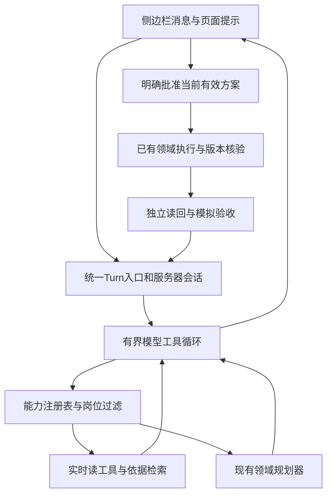

# 统一工作台 Agent 实施与验收规划

## Goal Capsule

把侧边栏从按页面和关键词分流的聊天入口，改成能发现能力、读取真实状态、解释业务、准备受控方案的统一工作台 Agent。保留现有业务页面、鼠标/高亮/逐字预演、人工确认、事务写入、独立读回、模拟验收和反馈系统。

目标仓库 web-ai-assistant；同一代码同步到 fzh-data 的 ops_assistant_demo。首版已实现统一读取/准备入口；能力目录、岗位过滤、服务端分发与 LangChain schema 已统一由 `AgentTools.CAPABILITIES` 生成。专项工单、路由和终端的既有页面流程仍保留，后续迁移须逐项通过端到端回归。

---

## Product Contract

### 问题与证据

当前前端 index.html 的表单、askOps、RouteUI.routes、BankTaskUI.routes 多次路由；后两者含 active() 条件。路由页可吞掉跨页工单提问，任务页可吞掉其他页请求。页面是上下文，不能作为排他意图。此前工单 ask 在无任务时只显示页面提示，analyze/start 在条件不符时直接 return，造成侧栏静默。

server.py:model_task、bank_agent.py、bank_task_agent.py 已有各自工具循环，所以“没有 Agent 循环”并不准确。缺的是统一能力发现、跨模块观察和同一会话事实。route plan 只允许 select_services，一条查询也可能被当成开通请求。展示层 log/sessionStorage 与 scenario_history/task_history/bank_history 不同；不能把聊天气泡存在误称为模型知道完整上下文。

现有 118 项确定性测试及既有真机主线证明部分业务契约，不能证明自然对话的覆盖率。模型调用禁用 thinking、max_tokens=900 是可疑限制，但没有对照试验，不能断言模型无责或开思考即能修复。需要先消除确定的 Harness 缺陷，再比较模型设置。

### Requirements

R1. 每次非空输入都有可见受理及终态回复；忙碌、无权限、无对象、未知能力、模型失败不能静默。

R2. 所有业务页的已知信息可由工具查询。覆盖柜面、联调、终端、注册参数、固定地址、接入工单、路由、知识依据、变更申请、当前工作区审计；培训和反馈提供明确导航与隐私边界。

R3. 跨页问法可用。询问当前页不改变页；明确指向另一个模块时工具可读取它；歧义先问，不默认修改。

R4. 查询、解释、建议、准备、预演、确认、执行区分清楚。查询不得创建任务/方案或改变业务；工单选择改变不得偷偷分析旧 task_id。

R5. 对话延续同一对象和必要答案；刷新可恢复，切身份/工作区不串话；重置后先读最新状态，旧事实不能充当授权。

R6. 模型有清楚的能力目录和业务依据，能读、比较、追问并用结果继续；每条状态或数量结论有成功读取来源。

R7. 任何写入由现有后端岗位/范围/版本/来源/摘要/有效期核验，人工批准后执行。读权限也逐工具核验。

R8. 演示观众先看到一到三句结论和下一步；展开可见真实工具名称、结果与错误，不能声称没运行的检查已运行。

### Acceptance Examples

AE1. 在路由页问“我们有几个工单？分别有什么区别”：读取目录，答三份并说明001补端口、002保守档资料齐、003模拟回调失败恢复；无变更。

AE2. 在接入工单页问“现在限额多少”和“这页缺什么”：分别读取柜面配置和当前工单，不硬分流或生成修改。

AE3. 选002说“核对这份工单形成方案”：先绑定002，目标4/45/0/8443；不得沿用001任务。无确定选中项时询问选择。

AE4. 同一轮补“9443”，刷新后问“接着办”：保留来源可用答案，重读当前版本；重置后必须识别旧任务失效。

AE5. 输入“开通余额和明细，不开票据”：能够理解明确排除，最终范围只有余额/明细；矛盾如“只开余额，同时开全部”才澄清。不得用遇否定一律报错替代意图理解。

AE6. “这几个路由已配置了吗？”只读；“改限额20万”准备并预演；“允许”绑定唯一当前有效方案，多个候选时询问，绝不按当前页面任意批准。

---

## Planning Contract

### 决策与成熟方案取舍

KTD1. 统一 /api/agent/turn 为侧边栏入口；复用现有 Store/BankOperations/BankTasks/RouteDemo 业务核验，不重写数据库和执行规则。页面按钮仍走同一领域方法。现有专用 Agent 先作为领域规划工具保留，避免第一阶段同时重写四套循环。

KTD2. 优先采用现成运行时，不把自建循环作为默认。实施前以相同的五条自然请求和两个现有领域函数做小型适配验证：首选 LangChain create_agent/LangGraph（Python、会话与审批/事件基础），备选 Pydantic AI（类型化工具、依赖注入、模型抽象），Pi-agent-core 作为已有Node/TS环境时的备选。比较当前模型兼容性、工具参数校验、会话隔离、错误回注、可恢复状态与集成代价。验证通过后选定一个，再展开U3；不能同时实现三套，也不能未经试验把“框架太重”作为拒绝理由。自建只允许保留领域适配和必要UI胶水，通用循环/消息配对/重试/事件优先复用框架。

KTD3. OpenAPI作为API能力事实来源：现有服务尚无完整OpenAPI规范，先为实际端点补充operationId、用途、输入/输出、错误、读写类别与确认前置条件；规范必须对照HTTP契约，不能描述不存在的能力。使用现成OpenAPI工具适配器或FastMCP转换做白名单只读接口验证，复用Schema而非手写第二份。领域规划/确认等复杂动作使用少量语义工具包装，不全量暴露底层CRUD、身份切换、反馈管理员接口或任意URL请求。MCP是可选接入协议，不是必须加的网络层。Skill是操作说明，知识是版本化证据，实时状态是工具结果。

KTD7. 网页助手前端优先参考并验证CopilotKit/AG-UI：现成的聊天/侧栏、共享状态、前端工具、进度事件正对应当前缺口。当前页面为原生JS，CopilotKit React组件可能需要迁移；先验证AG-UI与原有页面动作适配能否保留逐字填写/鼠标/高亮。若使用整套组件需要重做业务页，先保留现有外壳并接入框架事件，只写薄适配；记录试验依据。框架支持前端动作不代表自动理解任意未注册页面。

KTD4. 客户端只提交页面/选中对象提示；岗位、workspace、授权、实际记录与版本由服务器会话/数据库重建。客户端声称operator或提供其他工作区ID一律不能提升权限。

KTD5. 会话保留有界用户/助手/工具消息与结构化选中对象、未答问题、待确认引用；存SQLite，按会话主体与workspace隔离。不保存系统凭证或全量记录；裁剪完整工具消息组，不能留下无对应调用的结果。聊天事实与授权分离。

KTD6. 模型可读、规划；执行入口保留在人工确认路径。用明确的plan引用触发确认UI和现有执行，不授予模型 approve_self 或任意执行工具。普通查询自由读，准备必须满足来源与范围检查。

### 架构

会话运行经历 received → reading/planning → answered/needs_input/awaiting_confirmation/failed。批准是另一个受控动作；网络中断的运行标记为interrupted，刷新不自动重复写入。

---

## Implementation Units

### U1. 先固定失败问法与能力矩阵

要求R1–R4，AE1–AE3。文件 tests/test_agent_turn.py、tests/agent_cases.json、scripts/agent_eval.py（新增），现有tests保持。

为每项业务列出UI动作、后端领域方法、可调用工具、允许岗位、修改风险、真实来源。先固定“路由页查工单”“工单页查限额”“仅问状态不建任务”“busy仍回复”“002选择不使用001旧任务”失败案例。真实评估文件只记录脱敏输入、工具轨迹、时延、结论与断言，不能将录制回答用于现场兜底冒充实时模型。

验收：覆盖所有已知页和每项已有动作；明确不支持的能力也出现在目录。数量计数必须来自工具结果，不是写死三份。

### U2. 能力目录与观察工具

要求R2、R3、R6、R7。依赖U1。文件 agent_tools.py（新增）、server.py、bank_tasks.py、route_demo.py、tests/test_agent_tools.py（新增）。

注册 list_capabilities、read_workspace_context、list_workorders、read_workorder、read_records、read_configuration、read_pending_plans、search_rules、read_audit。每个工具提供明确description、枚举参数、输入/输出验证、读/计划标签、错误码与可恢复建议；服务器绑定workspace和role。read_records只允许领域集合，禁止任意SQL。隐藏值复用现有脱敏函数。知识按query、任务profile、版本和环境过滤；过期材料可以解释但不能授权目标。

验收：空列表诚实返回0；查不存在ID明确返回NOT_FOUND；低权限访问被拒；不可跨工作区读；未知字段不泄露；结果包含版本/来源。培训/反馈只提供入口和该用户已有的授权方式，不开放全量反馈读取。

### U3. 统一对话循环与领域规划桥接

要求R1、R3–R8，AE1–AE6。依赖U2。文件 agent_runtime.py、agent_session.py（新增）、server.py、domain.py、bank_task_agent.py、bank_agent.py、route_demo.py、tests/test_agent_runtime.py、tests/test_agent_session.py（新增）。

模型先看能力摘要及服务端当前上下文，自主选择只读工具；prepare_workorder/prepare_record_change/prepare_configuration/prepare_routes桥接已有领域能力。明确工单办理时可创建任务，询问时不得创建。引用selected_id必须校验；选择与当前task不一致则重新绑定，不能静默继承。保留必要的有界工具循环与一次可修正错误回注；权限/生产写入/对象失效为不可重试，缺参数应追问。

统一输出 turn_id、非空text、outcome、trace、ui_actions、pending_plan。空模型输出、非法JSON、耗尽预算、超时均有终态答复；回注每个tool_call的结果后再续轮，完整配对。初始预算最多6轮、12工具调用、最多一次领域规划器，累计模型调用共享预算与墙钟上限，防嵌套循环相乘；可恢复读失败只重试一次。

路由明确否定无需一律拒绝。先由模型结构化选择/排除与歧义，后台校验支持目录和本轮确定范围，再准备；既有explicit_services需相应调整并增加否定/矛盾/提示污染测试，不能简单删除范围护栏。

验收：无操作请求无方案；成功工具结果决定已读/已准备，不能靠正则压住模型成功措辞；后续“为什么”“它们区别”“继续”有正确对象；重启可恢复对话但不自动执行；模型故障不会修改业务；嵌套调用不超过全局预算。

### U4. 统一侧栏与批准反馈

要求R1、R3、R5、R8。依赖U3。文件 index.html、assistant_panel.js、bank_task_ui.js、route_ui.js、bank_ui.js、rehearsal_ui.js、tests/test_agent_http.py（新增），浏览器验收用例。

侧栏所有提交通过统一入口，删去active页面劫持与重复关键词分流。显示受理状态、正在读取的真实步骤、非空终态。busy回复具体状态或明确排队，不清空用户输入后吞掉。事件首期可用turn状态轮询；可靠重连后才考虑SSE，不为流式效果重新造复杂传输。

ui_actions是固定白名单，由页面适配器调用已有渲染/预演函数；禁止模型HTML/任意JS。查询保持当前页；明确办理时可导航。允许/取消绑定当前有效plan引用，经服务器重读校验再调用已有执行。整组工单、路由及单项修改都必须让侧栏知道结果，不只在页面msg展示。

验收：切页问跨模块仍有效；提交/刷新/关闭打开助手消息不丢；reader/reviewer均有非空拒绝；预演鼠标高亮逐字填写可见且未保存；“允许”零候选/多候选/失效方案均不会误执行。

### U5. 真模型评测与演示交付

要求全部，依赖U4。文件 scripts/agent_eval.py、tests/agent_cases.json、docs/competition-v2-results.md、docs/presenter-rehearsal.md、competition.html、AGENT_HANDOFF.md、docs/index.md、docs/log.md。

以当前模型做真实输入评测，不靠stub证明智能。先固定Harness同一模型对照旧实现；再小样本比较thinking关闭/供应商支持的开启设置和token预算，记录准确率、时延、调用量。配置兼容性以供应商当前官方资料及实际响应为准，不假设OpenAI兼容即支持所有参数。

每个失败归类为路由、观察、对象绑定、知识、工具参数、模型、权限、展示；报告包含失败原句与复测，不只给通过总数。成功阈值见下节。最后两仓同步、凭证扫描、已有PR提交推送、云端备份与部署；线上独立工作区验收后才标记可演示。无权访问真实反馈则明确说明，不用反馈目录替代业务目录。

---

## Verification Contract

确定性：现有118项维持全通过，新增用例覆盖R1–R8以及失效/越权/并发/重置/反馈隔离；不要仅用字符串包含断言证明正确。

真模型至少24条，分列表数量/解释比较、跨页当前状态、工单指代与换单、规则及否定条件、模糊范围、授权拒绝、重置刷新、确认恢复八类。关键AE1–AE6各复跑两次；安全与无静默100%，业务与对象正确率至少90%，所有关键案例100%。输入“贷款查询”只说明不支持不写入，不能伪装已检索到真实贷款规则。

浏览器必须真的从侧栏提交问题，不只调用window函数或HTTP端点；至少走完整001补缺→预演→批准→验收、002不同档位、003失败恢复和路由副线。输入“我们有几个工单”“有几条IP”“有哪些适配器”“这页能做什么”“当前待确认什么”“它们区别”“核对这份”“先别改，解释一下”覆盖入口。查询不能触发写API或建立任务。

体验目标：点击后立即受理；正常问答争取15秒内，超15秒明确进度，超过约60秒给可解释中断/重试；最终秒数按真模型结果记录。三页预演可看懂且总节奏适合6–8分钟，不虚报性能。

---

## Definition of Done

侧栏不再由当前页正则劫持；领域工具可发现且职责清楚；所有非空请求均终结于回答、追问、待确认或具体失败；实时状态和历史事实分离；批准仍独立受控；已知UI/API能力的差异都有明确解释；两仓、云端和交付说明一致；发布证据包含真实对话和浏览器验收，不能以118项测试替代。

## Risks and Deferred Work

保持独立模拟数据与6–8分钟剧本，不增加真实系统连接、SSO、全自动批准、任意浏览器控制、向量数据库、多Agent、OCR或Shell工具。依赖升级先证明必要性。当前反复热更新会使登录内存会话失效，实施时说明需重新登录并保护反馈SQLite；不删除业务/反馈历史。未来可增加MCP导出和LangGraph持久运行；目前优先统一观察与会话契约。

规划自审已处理：客户端role不能可信、工单只读不能偷建任务、选中对象与task不一致、嵌套预算膨胀、明确否定被误拒、侧栏确认可能误绑、模型参数未作对照。剩余执行期未知是提供商具体thinking兼容性、实际延迟以及需要多大历史预算；均由U5量化，不能预先宣称解决。

## Sources and Research

- [FastMCP OpenAPI集成](https://gofastmcp.com/integrations/openapi)：可转换现有API且有路由白名单；官方同时说明精心设计的工具通常优于复杂API的全量自动转换。
- [CopilotKit前端工具](https://docs.copilotkit.ai/agent-spec/frontend-tools)：将已有页面动作注册给Agent执行；需匹配前端技术栈与后端协议。
- [Pydantic AI官方文档](https://ai.pydantic.dev/)：Python运行时备选，具体模型及持久化适配需小样本验证。

- [Pi agent-core 官方README](https://raw.githubusercontent.com/badlogic/pi-mono/main/packages/agent/README.md)：确认存在通用状态化内核、上下文变换、工具事件、执行前后hook；不是仅有编码CLI。
- [MCP工具规范](https://modelcontextprotocol.io/specification/2025-06-18/server/tools)：工具发现、Schema、结构化结果、错误与访问控制；工具annotation不是授权。
- [LangChain agents 官方文档](https://docs.langchain.com/oss/python/langchain/agents)：成熟工具循环可作替代实现选择，仍须业务工具与权限适配。
- [Anthropic Building Effective Agents](https://www.anthropic.com/engineering/building-effective-agents)：环境观察和工具接口决定有效性，简单可组合模式需配真实评估。

来源查阅日期2026-10-13。结论来自当前代码与官方资料对照，未在本规划轮做新的运行时实验；历史测试不构成新实现验收。

## 2026-10-14 实施取舍

保留 LangChain：已有工具循环、统一注册与当前模型接入通过实测，当前缺口在业务工具覆盖和界面确认。Pi可作未来同工具同模型对照，尚无本项目对照证据支持更换运行时。MCP用于跨客户端工具发现；当前同进程注册表已能生成工具，无跨客户端接入需求，故暂不新增服务层。模拟知识规模有限，现有检索仍需按失败案例改进；没有证据表明增加向量库能修复确认或工具暴露问题。以上是当前范围取舍，不是对其它框架能力的否定。
